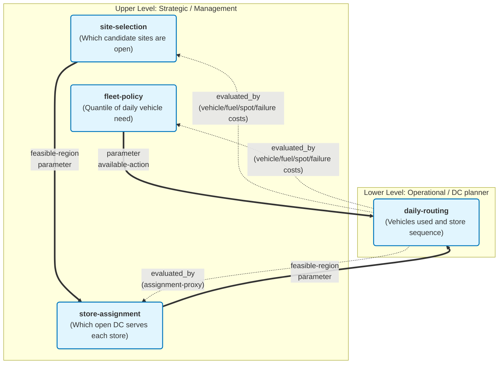

# Problem Definition: Distribution-Centre Network Redesign for Dasol Retail

**IE437 Midterm Project · Distribution-Centre Network Redesign — Formulating and Solving a Hierarchical Decision**

Author / student ID: [entry]

Date / version: 2026-10-29 · v0.3 (implemented model and saved full-population results; Sections 5–7 completed)

Summary: For the **1,970-store synthetic planning instance**, the best service-feasible design found has **11 DCs and 183 owned vehicles**. D28 monthly cost is **KRW 1.744625 billion**; H14 cost with the D28 fleet fixed is **KRW 1.747216 billion**. Held-out saving against the constructed historical baseline is **KRW 2.450571 billion/month (58.38%)**, with a conditional 95% paired-bootstrap interval **[2.431567, 2.462733] billion**. About **96.76% of that saving is eliminated modelled stockout penalties**, so it is not a bankable cash-saving estimate. The result uses the revised **290 km** route limit rather than the original 250 km. The untested density/thinning approximation remains the principal structural simplification; the route-limit relaxation and synthetic baseline are additional material limits.

Files: this document; [higher-level solver](../higher_level/README.md); [daily router](../lower_level/README.md); [saved full-run report](../code/results/higher_level/report.json); [recommended network](../code/results/higher_level/recommended.json). The client proposal is Section 6; no separate proposal file is asserted.

LLM tools and use: Claude (Anthropic, Sonnet 5.5), 2026-10-27 — structuring the problem (boundary, decisions, dependencies, classification) and drafting Sections 1–4 (2026-10-27 and 2026-10-28; Section 3 external facts checked by web search, sources cited beside the claims). Implementation and documentation assistance in this conversation: Codex (OpenAI), 2026-10-29. Section 7 contains three explicitly illustrative review discussions grounded in saved evidence; they are not verbatim transcripts.

Marking: `[ASSUMPTION]` = modelling choice; **R** = measured or directly recorded result; **P / Not run** = planned work without a saved result; `TBD` = a genuinely unresolved fact; `N/A — reason` = inapplicable. Monetary results apply to the synthetic 1,970-store instance and are monthly equivalents unless stated otherwise.

## 1. Decision, Scope & Problem Structure

**Business need.** Dasol Retail (fictional) serves about 10,000 convenience stores from 12 distribution centres (DCs). The store-to-DC assignment was fixed long ago, and several DC leases expire in sequence over the coming years. Management wants to know how many DCs to run and where, and what evidence supports the answer.

> Strategy & Planning, with management approval, uses the posterior predictive of store demand, road distances, candidate sites and cost parameters, once now (before the leases expire), to decide how many DCs to operate, at which sites, which stores each serves and under what fleet policy, in order to minimise total monthly cost (DC fixed cost, vehicles, fuel, spot trucks, service failures) while at least 98% of a day's deliveries arrive before 12:00.

### The four statements

| Statement | Level | Decision or component it concerns | Consequence for comparison |
|---|---|---|---|
| Strategy & Planning: "Cut the DCs from twelve to eight and lease and staff costs fall sharply." | **Evaluation of a decision** (one term only) | `site-selection` at k = 8; component `dc-fixed-cost` | Fixed cost is linear in site indicators, but prices differ: the selected 11 sites cost 334.550 M KRW/month versus 326.695 M for the 12-site baseline. Fewer sites did not reduce this term in the measured run. Only total monthly cost resolves the claim. |
| Delivery Operations: "Fewer DCs means longer routes, more vehicles; it may end up costing more." | **Evaluation of a decision** (the complementary terms), stated as a hypothesis about sign and size | `site-selection` → `store-assignment` → `daily-routing`; components `vehicle-fixed-cost`, `fuel-cost`, `spot-hire-cost`, `failure-cost` | Directly commensurable with Strategy & Planning: both are terms of the same total monthly cost `E(k)`. Neither claim is decided alone; only their sum over k (the sweep) answers whether the saving is outweighed. |
| Data Team: "The volume-weighted centre of gravity is the optimal site; it takes minutes." | **Method for taking a decision** (candidate generation, the cheap criterion `G`) carrying an unverified validity claim ("optimal") | `site-selection`, via `G` | A method is judged by what the full evaluation `E` says about its output, not by its own score: prediction quality (how well `G` predicts `E`) and decision quality (how much the `G`-best candidate loses under `E`). It is compared with other generators and selection rules at the same budget, not with the cost claims. It does not choose k, and ignores capacity bounds, assignment, vehicle limits and the window. |
| Field Manager: "The centre of gravity may land across the river; trucks drive to the bridge." | **Claim about the validity of a model** (the distance component) | Road distances `l_uv` feeding `fuel-cost`, `route-limits`, `noon-share`, `pair-eligibility`, `assignment-proxy` and `G` | Not a cost and not a decision, so it has no common scale with the other three. It is a validity condition on all of them: tested by the calibration error of distances against road values and by the `G`–`E` gap. It also supports restricting sites to leasable candidates and computing `G` on road rather than map distance. |

**Consequence.** Two statements (Strategy & Planning, Delivery Operations) are evaluations on one scale (KRW per month) and combine into `E(k)`. The Data Team's statement is a method, ranked only through `E`. The Field Manager's statement is a validity claim about an input of all the others and is checked, not summed.

### Boundary

- **One decision problem (upper):** one network redesign chosen now for a steady-state planning horizon. Every current site can be kept or given up and every candidate site can be leased; the 12 current sites are themselves candidates. Demand is represented by sampled days from the posterior predictive (Section 3).
- **One decision problem (lower):** one DC's delivery plan for one day, solved after that day's orders are known (orders by the evening cutoff, routes planned the evening before).
- **Excluded, with consequences:**
  - The sequence of lease expiries (an extension). The result is a one-shot design and ignores transition cost and ordering. A sequential version would be Stateful.
  - The fresh-food second wave (out of scope per brief). Fleet need and kilometres are understated if it shares vehicles.
  - Multiple trips per vehicle, driver breaks, time-of-day traffic, dock congestion, stock or backlog carried between days (details in 2a).
  - Opening and closing of stores during the horizon: the store set is fixed.
  - Transition cost of closing or opening a DC. The recommendation is not a migration plan.
- **Current practice versus constructed baseline.** The company's actual practice (12 DCs, historical assignment, experience-based routes) is unknown here; no real operational data are available for this fictional company. The **baseline** is constructed: the 12 generated current sites with the generated historical assignment, scored by the same `E`, the same sampled days and the same routing method as every candidate. The baseline is exempt from the capacity bounds. A second reference attempts to re-solve assignment at the same 12 sites. In this run it is infeasible for 123 stores, so it cannot separate assignment-only savings from network-change savings.

### Decisions and dependencies

| Decision ID | What is chosen | Level | Approved by | How it is handled in the prototype |
|---|---|---|---|---|
| `site-selection` | Which candidate sites are open: set `S`, with `k = card(S)` | Upper | Management (proposed by Strategy & Planning) | Searched under budget `B` |
| `store-assignment` | Which open DC serves each store | Upper | Management | Re-solved inside every evaluation as a capacitated assignment LP (rationale in 2b) |
| `fleet-policy` | The quantile `q` of daily vehicle need that fixes owned vehicles per DC | Upper (candidate attribute) | Management / Delivery Operations | `q = 2/3` default; owned fleet `N_j` is derived by the rule `fleet-rule` |
| `daily-routing` | For one DC and one day: vehicles used and the store sequence of each | Lower | DC planner (in reality; the prototype computes it) | Heuristic solve (method in Section 4) |

Not decisions (supporting analyses): the demand model and its posterior predictive, distance lookup and its calibration, the cheap criterion `G`, the sweep over k, the surrogate and acquisition rule, and the sampled-day draws. Prediction and simulation alone do not decide anything; the decision they support is `site-selection`.

**Dependencies** (`parent → child: what changes`):

```text
site-selection → store-assignment : feasible-region (stores may go only to open sites),
                                    parameter (per-site min/max store bounds)
store-assignment → daily-routing  : feasible-region (the store set of DC j),
                                    parameter (n_j, demand vector, distance sub-matrix, the 2% noon budget)
fleet-policy → daily-routing      : parameter (owned fleet N_j = threshold above which spot trucks are paid),
                                    available-action (vehicles free of charge)
site-selection — fleet-policy     : no directed dependency (chosen together in one candidate, same level)
```

**Evaluation relations** (written separately from dependencies):

```yaml
- id: dc-fixed-cost
  decision: site-selection
  evaluated_by: none          # closed form
- id: vehicle-fixed-cost, fuel-cost, spot-hire-cost, failure-cost
  decision: site-selection, fleet-policy   # cost of the candidate (S, q)
  evaluated_by: daily-routing # run on every DC in S over the sampled days
- id: assignment-proxy
  decision: store-assignment
  evaluated_by: daily-routing # the distance proxy is judged by the routes it produces
```

The parent changes the child's problem (dependencies); the child supplies an evaluation of the parent (`evaluated_by`). Receiving that evaluation is not by itself Feedback.

### Classification

| Object | Property | Classification (or unresolved status) | Structural evidence or question to resolve |
|---|---|---|---|
| Decision dependency graph | Decision Structure | **Hierarchical** | Three directed edges, each changing the child's feasible region, parameter or available action (see Dependencies). Multiple decisions alone would not make it hierarchical; the edges do. |
| `site-selection` | State Structure | Stateless | One design chosen now; no state carried between decision epochs; no State-transition component. The lease sequence is excluded; including it would add a state (open DCs, remaining leases). Sampled demand days are draws of a parameter, not a state. |
| `site-selection` | Information Structure | Open-loop | Chosen once from information available now. Basis: `operational-requirement` (leases fix the network for years). The surrogate search reads the results of its own earlier evaluations; this is the algorithm using its logged evaluations, not newly observed future information. |
| `store-assignment` | State Structure | Stateless | One assignment for the horizon; no transition. |
| `store-assignment` | Information Structure | Open-loop | Fixed long-term (the existing assignment has barely changed). Basis: `operational-requirement`. Daily re-assignment of stores between DCs is excluded (`design-decision`). |
| `fleet-policy` | State Structure | Stateless | One quantile policy; no transition. |
| `fleet-policy` | Information Structure | Open-loop | Owned fleet is fixed before any day's demand is known. Spot hiring is the daily reaction and belongs to `daily-routing`. Basis: `operational-requirement`. |
| `daily-routing` | State Structure | Stateless `[ASSUMPTION]` | Load and arrival-time recursions are relations inside one plan, not transitions between decision epochs. Assumes no carry-over of unmet demand, stock or vehicle availability between days. Confirm with Delivery Operations (`TBD`, Section 3); if carry-over matters, this becomes Stateful. |
| `daily-routing` | Information Structure | Open-loop | The day's orders are known when routes are planned; travel times are deterministic in the model; the sequence is fixed before departure. Basis: `operational-requirement` (routes planned the evening before). In-day re-routing is excluded (`design-decision`); it would be Feedback. |



**Information timing across levels.** The upper decisions know only the distribution of demand (posterior predictive). Demand for day d is revealed to the lower level when its problem begins. This is a difference in what each problem knows, not Feedback inside either. `[ASSUMPTION]` If the boundary were redrawn as one problem "network plus a policy for daily reaction to demand", routing would be a recourse and the whole problem would be Feedback; the two-problem boundary above is a `design-decision`, chosen because the two decisions are taken by different people at different times.

**Execution is separate.** In reality `daily-routing` runs every evening; in the prototype it runs on sampled days. Daily re-execution of an independent problem does not make it Feedback, and the number of solver calls is not a state.

## 2. Computable Problem

### 2a · The lower level — one DC's daily operation

**Given** (for DC `j` and day `d`): the stores `I` assigned to `j` (`n = card(I)`); demand `q_i` in roll cages for each store on that day (a sampled day); road distance `l_uv` (km) between nodes (node 0 is the DC), symmetric `[ASSUMPTION]`; travel time `t_uv = 60·l_uv / v` minutes with `v = 35 km/h`; stop time `s = 15 min`; departure `τ0 = 05:00` for all vehicles `[ASSUMPTION]` (the brief allows 04:00–07:00; `TBD` with Delivery Operations); owned fleet `N` (a parameter passed down; `N = 0` in the sizing pass, see 2b); limits `Q = 48` cages, `M = 25` stops, `L = 290` km in the recorded configuration (original specification: 250 km), route duration `T = 10 h` `[ASSUMPTION]` (loading treated as outside this duration; if loading counts inside the 10-h shift, `T` falls to about 9 h; `TBD`); noon budget `α = 2%`; rates `c_f = 350` KRW/km, `c_s = 550,000` KRW per spot truck-day, `p_14 = 120,000` KRW per delivery after 14:00, `p_so = 500,000` KRW per undelivered store; optional spot-truck availability cap `κ` (recorded run: no cap; real market availability remains `TBD`).

**Route set.** `R` is the set of feasible routes `r = (0, i_1, …, i_m, 0)`, each satisfying `Σ q_i ≤ Q`, `m ≤ M`, `len(r) ≤ L`, `duration(r) ≤ T`. Arrival at the h-th stop is `a_{i_h} = τ0 + t_{0,i_1} + Σ_{g<h} (s + t_{i_g,i_{g+1}})` (minutes since midnight). Let `n12(r)` and `n14(r)` count stops with `a > 12:00` and `a > 14:00`.

**Decided.** `λ_r ∈ {0,1}` (route `r` is driven; one vehicle each), `u_i ∈ {0,1}` (store `i` not delivered), `σ ≥ 0` (spot trucks hired). The vehicles used are `V = Σ_r λ_r`.

**Objective** (minimise daily operating cost, KRW):

```text
min  c_f · Σ_r len(r) λ_r  +  c_s · σ  +  p_14 · Σ_r n14(r) λ_r  +  p_so · Σ_i u_i
s.t. Σ_{r ∋ i} λ_r + u_i = 1          for every store i       (served once or stocked out)
     σ ≥ Σ_r λ_r − N,   σ ≥ 0          (and σ ≤ κ if a cap applies)
     Σ_r n12(r) λ_r ≤ floor(α · n)     (at most 2% of the DC's stores arrive after 12:00)
     λ_r, u_i ∈ {0,1}
```

This is a set-partitioning vehicle-routing problem with side constraints (capacity, stops, distance, duration and a time-window budget). It is combinatorial (NP-hard), so the solution method is a heuristic chosen in Section 4. Recorded evaluation timings and a development microbenchmark are reported in Sections 4.3 and 5; the larger exact-solver accuracy study has not been run.

**Modelled and omitted.**

| Feature | Treatment | Reason / consequence |
|---|---|---|
| Load, stops, distance, duration limits | Modelled (hard) | Core of the brief. With τ0 = 05:00, travel can make time to noon bind before 25 stops. A binding-constraint frequency is not available in the saved network summaries. |
| Stop time and constant road speed | Modelled (15 min, 35 km/h) | Brief's defaults; the 30–45 km/h sensitivity remains Not run. |
| Single vehicle type, one trip per vehicle | Modelled | A second trip would lower vehicles needed in dense territories; fleet need is overstated there. Omitted for tractability. |
| Driver breaks | Omitted | Would shorten feasible routes (understates vehicles). Not in the brief. |
| Time-of-day traffic | Omitted | Peak slowdowns flatter long routes; speed sensitivity partly covers it. |
| Loading-dock congestion, staggered departures | Omitted (single departure time) | Staggering would let long routes leave earlier; omission is conservative for them. |
| Empty-cage collection | Omitted | No load or time effect assumed. |
| Fresh-food second wave | Out of scope | Per brief. |
| Carry-over between days | Omitted `[ASSUMPTION]` | Makes `daily-routing` Stateless; to confirm. |

**How the delivery window enters.** Hybrid, stated explicitly. The 98%-before-noon requirement is a **hard side constraint per DC-day** (`α = 2%`), with the additional acceptance test below to conservatively enforce chain-wide 98% (`TBD`: whether the company means per DC or chain-wide). Delivery after 14:00 and non-delivery are **penalised** (soft, 120,000 and 500,000 KRW). The realised chain-level share before noon is reported for every network. Because the noon constraint is on the routes, a larger territory needs more vehicles, which is the mechanism behind Delivery Operations' claim.

**As implemented.** The routing hard bound counts delivered stops after noon. Upper-level acceptance additionally requires `n12 + unserved ≤ floor(0.02 n)` for every DC-day and at least 98% of all assigned stores delivered before noon on every sampled chain-day. An undelivered store is a service failure; `status=ok` alone does not establish compliance. Every assigned store, including a zero-cage store, requires a visit or an explicit failure. The 290 km setting is a model revision, not evidence of compliance with 250 km.

**One solve returns upward** (per DC-day): vehicles needed `V`, kilometres, stops per route, `n12`, `n14`, undelivered stores `u`, spot trucks `σ`, and the operating cost.

### 2b · The connection

**Passes down:** the open set `S`, the fleet policy `q`, and the sampled demand days `D` (posterior-predictive draws, shared across all candidates and the baseline as common random numbers, to reduce sampling noise in differences). The assignment `A_j` is derived inside the evaluation from `S`.

**Passes up:** per DC-day `V`, km, `n12`, `n14`, `u`, `σ`; aggregated into expected monthly operating cost, owned vehicles and realised service level.

**One evaluation `E(S, q)`:**

1. Solve the assignment LP for `S` (reject `S` with the reason if infeasible).
2. **Sizing pass:** for each `j ∈ S` and `d ∈ D`, solve the lower level with `N = 0` (every used vehicle priced as a spot truck, with fuel and failure penalties still in the objective) and record `V_{j,d}`.
3. `N_j = ceil(Q_q({V_{j,d}}))`, the `q`-quantile of daily need (`fleet-rule`; `q = 2/3` default), weighted by the sampled-day weights `ω_d` (Section 3.4).
4. **Accounting:** spot trucks `σ_{j,d} = max(0, V_{j,d} − N_j)`, with the routes of step 2 frozen `[ASSUMPTION]`. This omits re-optimization after vehicles become owned. Its difference from an owned-fleet reoptimization policy has not been quantified; the reported comparisons consistently use frozen routes.
5. `E = F(S) + c_v·ΣN_j + D_m · Σ_d ω_d Σ_j [c_f·km + c_s·σ + p_14·n14 + p_so·u]`, with `D_m = 30.4` days per month `[ASSUMPTION]` and day weights `ω_d` summing to 1 (equal when dates are drawn uniformly; stratified weights in Section 3.4).

**Cost of one evaluation:** `k · card(D)` lower-level solves plus one assignment LP. With 7 sampled days, k = 8 gives 56 solves. With 28 days, 224; the 14 held-out days add 112; the baseline costs 12 × (28 + 14) = 504 solves. The selected 11-DC D28 evaluation took 77.366 s for 308 DC-day solves including assignment and matrix work; pure routing timings are distinguished in Section 4.3.

**Where demand uncertainty enters.** Only through `D`, in the lower level: fleet size (an order statistic) and spot hiring are not linear in demand, so an average day can miss their cost. Here the mean-day and D28 owned fleets are equal, while the mean day misses spot cost. Sampled days include a chain-wide calendar draw, so costs are correlated across DCs. **Averaged away (simplification):** `store-assignment` and `G` use posterior-mean volumes `w_i`; this goes in the Section 4 table. The fleet is sized and scored on the same sampled days, which is optimistic for spot cost; the held-out days measure the effect.

**Place of the assignment.** It is a decision (`store-assignment`) but **not part of the searched candidate**; it is re-solved inside each evaluation. Reasons: (i) for fixed `S` it is a transportation problem with bounds (an LP with integral vertices), exact and fast; (ii) putting about 2,000 store-to-DC choices into the candidate would give a search space a few dozen evaluations cannot learn; (iii) every candidate then gets a consistent, reproducible assignment. Cost: the LP minimises a distance proxy (`assignment-proxy`), not route cost, so compact routing and the window can be missed; this feeds the `G`–`E` gap and is a candidate check for Section 4. The constructed baseline keeps its generated historical assignment; the attempted second reference re-solves it but is infeasible in this run.

### 2c · The upper level — how many DCs, and where

**Variables and domains.** `y_j ∈ {0,1}` for each candidate site `j ∈ C` (`card(C) = 60`, including the 12 current sites); `k = Σ y_j`; `x_ij ∈ {0,1}` (store `i` served by `j`; derived by the LP, not searched); `q` (fleet quantile, base value 2/3). A **candidate** is `(S, q)`.

**Objective and constraints:**

```text
min over (y, q):  E(y, q) = Σ_j f_j y_j  +  c_v Σ_j N_j(y, q)  +  D_m · E_d [ Σ_j Φ_j(A_j(y), d, N_j) ]
                  where Φ_j is the ideal lower-level value (2a); the implementation uses heuristic sizing routes and frozen-route accounting (2b)

s.t. Σ_j x_ij = 1                         every store assigned once
     x_ij ≤ y_j,  x_ij ≤ elig_ij          only open sites; eligibility (a single-store route meets noon and the km/duration limits)
     min_j · y_j ≤ Σ_i x_ij ≤ max_j · y_j  store-count bounds per open DC (new designs only; baseline exempt)
     realised share of deliveries before 12:00 ≥ 98%   (tested per chain-day and DC-day, with unserved stores counted as failures)
```

**Necessary range of k, with observed status.** For 1,970 active stores, 100-store minima and site maxima of 200/280, the capacity-based range is **8 ≤ k ≤ 19**. This alone does not certify feasibility. The recorded p-median MIP **proved k=8 infeasible**. At **k=9**, the 20 s time limit expired without an incumbent and the fallback found no feasible seed: status is **unknown, not proven infeasible**. Seeds were obtained for k=10–19. k=10 has an accepted D28 design; k=11 is the lowest-cost accepted design found, not the minimum demonstrated feasible count. [Feasibility](../code/results/higher_level/feasibility.json), [pool certificates](../code/results/higher_level/pool.json), [sweep](../code/results/higher_level/sweep.json).

**Convex or linear, and combinatorial.**

- *Linear:* the fixed-cost term; the assignment for fixed `S` (transportation LP, exact); the LP relaxation of the capacitated p-median, which gives a lower bound for `G`.
- *Convex:* the one-site weighted-distance (Weber) problem under map distance. It is not convex on road distance, which is the Field Manager's point.
- *Combinatorial:* the choice of `S` (about 2.6 × 10⁹ subsets for k = 8 of 60 sites); the fleet quantile (an order statistic); and `Φ_j`, an NP-hard routing problem with no closed form.
- *Implication:* `E` is a black box, so no exact optimum of `E` is available. Exact solution is possible only for `G` (capacitated p-median as a MIP for each k) and for the lower level on small instances (to measure heuristic accuracy). The upper level is therefore searched under a budget `B` (Section 4).

### I/O schema

| Input / output | Table or parameter | Field | Type / unit | Meaning; one row is … |
|---|---|---|---|---|
| Input | `stores` | `store_id`, `region`, `lat`, `lon`, `store_type`, `opened_on`, `closed_on`, `current_dc_id` | text; text; decimal degrees; enum (residential / office / mixed / roadside); date; date or null; text | one store (all stores, or the thinned fraction) |
| Input | `demand_history` | `store_id`, `date`, `cages_ordered` | text; date; integer (roll cages) | one store on one day, last 12 months; feeds the demand model |
| Input | `dcs` | `dc_id`, `lat`, `lon`, `lease_expires_on`, `monthly_fixed_cost`, `max_stores`, `min_stores` | text; degrees; date; KRW; integer | one current DC (12 rows) |
| Input | `candidate_sites` | `site_id`, `lat`, `lon`, `monthly_fixed_cost`, `max_stores` | text; degrees; KRW; integer | one synthetic candidate site, 60 rows, including the 12 current ones; real leasability unverified |
| Input | `cost_parameters` | name, value, unit | fuel 350 KRW/km; vehicle 5.5 M KRW/month; spot 550,000 KRW/day; late 120,000 KRW; stock-out 500,000 KRW; capacity 48 cages | one parameter |
| Input | model parameters | `v`, `s`, `τ0`, `T`, `M`, `L`, `α`, `q`, `D_m`, `κ`, thinning fraction, sampled-day counts (7 / 28 / 14), `B` (default 40), seeds | km/h; min; clock time; h; count; km; share; share; days; count; fraction; counts; count; integer | one scalar setting |
| Input | `road_distance` cache (ours) | `from_id`, `to_id`, `km`, `source` | text; text; km; enum (engine / calibrated detour) | one point pair; source, version, extract date stated in Section 3 |
| Output | recommended network | `site_id` list, `k`, `store_id → dc_id`, `N_j` per DC | text list; integer; text pairs; integer | the recommended `S`, its assignment and owned vehicles |
| Output | cost breakdown | component (the five cost components plus total), `mean`, interval on sampled days, interval on held-out days | text; KRW/month; KRW/month | one cost component of one network (baseline and recommended) |
| Output | service level | realised share before 12:00, share after 14:00, undelivered | share per network | one network |
| Output | evaluation log | `eval_id`, `S`, `q`, `k`, `G`, `E`, selection rule, seed, days used | integer; text list; number; KRW/month; text | one full evaluation (every one of the `B`) |
| Output | sweep | `k`, best `E`, `F`, operating cost | integer; KRW/month | one number of DCs |
| Output | `G`-versus-`E` table | candidate, `G`, `E` | KRW/month | one evaluated candidate |
| Output | lower-level run | route id, store sequence, km, stops, arrival times, late flags, vehicles, spot | mixed | one route on one DC-day |
| Output (baseline history) | `deliveries`, `vehicle_days`, `spot_hires` | as in the brief's Section 2.5 | as in the brief | planned separate tables; this run records equivalent simulated aggregates in evaluation JSONs |

### The two criteria

- **Full evaluation `E(S, q)`:** fixed cost + vehicle cost + `D_m` × the `ω_d`-weighted mean over sampled days of [fuel + spot + failure cost], with the assignment re-solved, the lower level solved for every DC on every day, and the fleet from the quantile rule (procedure in 2b). Expensive: `k · card(D)` routing solves per candidate; with the real routing system it would take hours.
- **Generation criterion `G(S) = F(S) + λ · P(S)`:** `P(S)` is the capacitated p-median assignment cost on **road** distances weighted by posterior-mean volume (the `assignment-proxy` value), and `λ` (KRW per cage-km per month) is a scale constant, calibrated on the historical baseline (Section 4.3). Cheap: one LP, or a MIP for the G-best set for each k.
- **What `G` ignores:** route sequencing (star distance replaces tour length), the 25-stop / 290-km / 48-cage limits and therefore the vehicle count, the stop time and the noon window, the fleet quantile and spot hiring, penalties for failures, demand variability (it uses means), and that the assignment minimises distance rather than route cost.

### Components

Roles and Models are kept separate (reference, Section 3). There is **no State-transition component** (`N/A — all decisions Stateless`) and **no Simulation component**: the sampled-day evaluation is a Monte Carlo average of a parameter (demand), and arrival times follow from an explicit recursion, not from executing system time and events. **No evaluation component is Data-driven.** The demand model is a supporting analysis that supplies parameters; the detour calibration supplies distance parameters. Neither is a learned relation from context and decision to outcome.

| Component ID | Decision ID | Role: Cost / Constraint / State-transition | Model: Formulation / Simulation / Data-driven | Definition, units, and evidence / assumption / unknown |
|---|---|---|---|---|
| `dc-fixed-cost` | `site-selection` | Cost (minimise) | Formulation | `F(S) = Σ_{j∈S} f_j`, KRW/month; default 150 M per DC, scaled with thinning; site-specific, higher in the capital region (fictional). |
| `vehicle-fixed-cost` | `fleet-policy` | Cost (minimise) | Formulation | `c_v · Σ_j N_j`, KRW/month; 5.5 M per vehicle including driver. |
| `fleet-rule` | `fleet-policy` | Constraint | Formulation | `N_j = ceil(Q_q({V_{j,d}}))` over sampled days; `q = 2/3` default. Uses sizing-pass outputs from `daily-routing`; an in-sample estimate. |
| `fuel-cost` | `daily-routing` | Cost (minimise) | Formulation | `c_f · Σ_r len(r) λ_r`, KRW/day; 350 KRW/km on cached road distances. |
| `spot-hire-cost` | `daily-routing` | Cost (minimise) | Formulation | `c_s · max(0, V − N)`, KRW/day; 550,000 KRW per truck-day; no cap in the recorded run; real availability remains `TBD`. |
| `failure-cost` | `daily-routing` | Cost (minimise) | Formulation | `p_14 · (deliveries after 14:00) + p_so · (undelivered)`, KRW/day. |
| `load-limit` | `daily-routing` | Constraint (hard) | Formulation | `Σ q_i ≤ 48` cages per route; `q_i` from the posterior predictive. |
| `route-limits` | `daily-routing` | Constraint (hard) | Formulation | At most 25 stops, 290 km, and duration `≤ T`; stop time 15 min, speed 35 km/h. |
| `noon-share` | `daily-routing` | Constraint (hard) | Formulation | At most `floor(0.02 n)` stores arrive after 12:00 per DC-day; arrivals from the recursion in 2a. |
| `cover-once` | `daily-routing` | Constraint (hard) | Formulation | Each store is visited once or counted as undelivered. |
| `capacity-bounds` | `store-assignment` | Constraint (hard) | Formulation | Store count of each open DC between `min_j` and `max_j` (scaled if thinned); baseline exempt. |
| `pair-eligibility` | `store-assignment` | Constraint (hard) | Formulation | Store `i` may go to DC `j` only if a single-store route meets noon and the km/duration limits. |
| `assignment-proxy` | `store-assignment` | Cost (minimise) | Formulation | `Σ w_i · l_{i,j(i)}`, cage-km/day, posterior-mean volume `w_i`; a proxy for routing cost, judged by `daily-routing`. |

**Where the demand model supplies parameters:** sampled `q_i^d` to `load-limit` (and so to vehicles, kilometres, `fleet-rule` and the spot and failure costs); posterior-mean `w_i` to `assignment-proxy` and `G`. **Distances** (`l_uv`, `t_uv`) supply `fuel-cost`, `route-limits`, `noon-share`, `pair-eligibility`, `assignment-proxy` and `G`.

**Hard constraints versus preferences.** Hard: `capacity-bounds` (new designs only), `pair-eligibility`, `load-limit`, `route-limits`, `noon-share`, `cover-once`. Priced preferences: spot trucks, deliveries after 14:00, undelivered stores.

**Infeasible inputs** are reported, never silently repaired:

- A set `S` with `Σ max_j < n` or `Σ min_j > n`, or in which some store is eligible for no open DC, is rejected with the reason (stores or bounds responsible).
- A store demand above 48 cages raises a data error (not expected at the default mean of about 2.2 cages).
- A day the fleet cannot cover (spot cap `κ` binding) yields undelivered stores priced at `p_so`, and the result is flagged as not meeting the service level.
- Duplicate or missing IDs, non-finite coordinates or distances absent from the cache stop the run with a field-specific message.

**Follow-up questions (reference, Section 5).** *Stateful:* N/A — all decisions Stateless. *Feedback:* N/A — all decisions Open-loop. *Formulation:* answered above (variables, objective, hard and soft constraints, parameters, feasibility, infeasible-input handling). *Simulation:* N/A — no Simulation component. *Data-driven:* N/A for evaluation components (demand model and distance calibration are in Section 3). *Hierarchical:* parent and child decisions, what is passed or changed, and `evaluated_by` are in Section 1 and 2b; no feedback relationship is claimed.

## 3. Information & Uncertainty

**Status (R, 2026-10-29).** Demand fitting, distance calibration and the full 1,970-store optimization have saved results. Sections 3–5 distinguish these from the earlier design plan. Sources are [report.json](../code/results/higher_level/report.json), [demand model](../code/demand/model.json), [calibration](../code/cache/detour_model.json) and [OSRM metadata](../code/cache/osrm_meta.json). Facts absent from the artifacts remain unresolved; configuration choices are not confirmations from a real client.

### 3.1 The instantiated data

The executed instance uses synthetic South Korean geography and master seed 437. The generator uses one RNG stream for tables/history; calibration, planning days and search/control use named `SeedSequence` branches. The original claim that every generation component already had an independent sub-seed is not supported by [generate.py](../generator/generate.py).

| Table / artifact | Recorded implementation and counts | Consequence |
|---|---|---|
| [stores](../data/stores.csv) | 2,000 generated rows; 1,970 active planning stores. All-row regions: capital 1,013, other-metro 777, rural 210. Types: residential 895, office 404, mixed 493, roadside 208. Broad coordinate mixtures replace the proposed 20-cluster road-snapped generator. | Thirty inactive stores are excluded. Synthetic geography requires validation before deployment. |
| [demand history](../data/demand_history.csv) | 714,255 store-day observations, 2025-10-28 to 2026-10-27. Log-normal type rates use sigma 0.45, clipped to [0.5,6]; counts are **Poisson**, not the proposed overdispersed negative-binomial generator. | The observed residual-dispersion check determines the fitted likelihood. |
| [current DCs](../data/dcs.csv) | Twelve randomly selected candidates; historical assignment uses nearest generated coordinates. The proposed historical capacitated 12-median plus relocations was not implemented. | The baseline is not evidence of competent real historical practice; this materially affects savings. |
| [candidate sites](../data/candidate_sites.csv) | Sixty synthetic sites, including the current twelve. Forty-seven have maximum 280 stores and thirteen maximum 200; ordinary minimum 100. Base fixed cost 30 M KRW with location multipliers/noise. | Availability, motorway access and industrial land use are not verified. The proposed OSM-based site selection is not claimed as executed. |
| [cost parameters](../data/cost_parameters.csv), [configuration](../config.py) | Fuel 350 KRW/km; owned vehicle 5.5 M/month; spot 550,000/day; after-14:00 penalty 120,000; stockout penalty 500,000/store; capacity 48 cages. Executed maximum **290 km**, speed 35 km/h, 15-minute stops, departure 05:00, duration 600 min. | Nationwide tables/model/day files determine instance size. Legacy configuration values of 160 stores, two DCs, 50–120 store bounds and 3/5/3 day counts do not describe this run. |
| Baseline operation outputs | Daily fleets, unserved counts, kilometres and costs are in evaluation JSONs. Separate actual-company `deliveries`, `vehicle_days` and `spot_hires` tables are not supplied. | Baseline operation is model output, not observation. |

**Scale/extrapolation.** The original target was φ=0.2 of a 10,000-store chain; the program directly generates 2,000 synthetic stores and plans for 1,970 active ones. It does not provide a measured full-density 10,000-store comparison. The 8–20 count range at n=2,000 becomes 8–19 at n=1,970. The square-root spacing argument remains theoretical. Full-density solve time and the stability of k at real stop density remain **TBD / Not measured**.

### 3.2 Distances

The [offline lookup](../distances/lookup.py) uses engine distances for site–store pairs and store–store pairs within 60 km, with calibrated haversine multipliers for uncached long store–store legs.

| Item | Recorded evidence and remaining limit |
|---|---|
| Engine/cache | [OSRM metadata](../code/cache/osrm_meta.json): car-profile engine, extract date 2026-10-29, **1,186,390 directed records**, 60 km store–store radius, **543.7 s** build time. Both directions are stored under symmetry; these are not that many unique unordered pairs. |
| Extract/version audit | Original OSM PBF hash/download audit and installed OSRM version are absent: **TBD**. The report's Parquet hash identifies the cache, not the original road extract. |
| Vehicle/time model | Car-profile km, symmetric, no truck restrictions; time at 35 km/h plus 15-minute stops. One-way and truck-access effects remain unvalidated. |
| Snap quality | Calibration rejects snaps beyond 500 m and records replacements. The generator does not establish that every input store/site passes that rule. Calibration acceptance is not a global geography-quality certificate. |
| Calibration sample | **1,000 valid unique pairs: 700 training / 300 validation**; 925 rejected attempts replaced. Bands 0–10, 10–30, 30–60, 60–150, 150+ km; endpoint-based area labels. Han opposite-bank screening includes river-related endpoints; actual bridge crossings were not verified. |
| All-band validation | **MAPE 12.2693%, bias +4.1069%, MAE 5.6502 km**, n=300. |
| Long-pair validation | Beyond 60 km: **MAPE 5.8402%, bias +0.7186%, MAE 10.8255 km**, n=90. These stratified-sample metrics are not weighted by driven-leg frequency. |
| River-screen validation | **MAPE 14.8016%, bias +9.1077%, MAE 2.8208 km**, n=75; endpoint screening, not verified river-crossing routes. |
| Long-distance multipliers | At 60–150 km, capital/other-metro/rural: **1.2996 / 1.3839 / 1.3094**. At 150+ km: **1.2958 / 1.2139 / 1.2446**. Fallbacks use training observations only. |

Source: [detour_model.json](../code/cache/detour_model.json). Recorded input hashes match the current store, site, DC, costs, fitted-demand, posterior, Parquet and calibration files. The current 290 km configuration reproduces the report's all-site eligibility counts. The main report lacks a complete routing-parameter snapshot, so this revision is disclosed rather than inferred from `bounds_overridden=false`, which concerns store-count overrides.

### 3.3 The instance: thinning and placement

- **Executed population:** 1,970 active stores; the [full-run scope](../code/results/higher_level/report.json) is not the earlier 200-store diagnostic subset and not a measured real 10,000-store operation.
- **Scaling:** φ=0.2 gives base fixed cost 30 M KRW and ordinary bounds 100–280; thirteen smaller sites have maximum 200. Vehicle, fuel, spot and penalty rates are not scaled.
- **Density:** each store remains one visit or failure, including zero-cage stores. Thinning changes route geometry and can bias k. The denser capital-region check has **not** been run.
- **Placement:** synthetic random candidate points, a random current-site subset and coordinate-nearest historical assignment. Proposed motorway/land-use selection and historical 12-median placement remain future improvements.
- **Route-limit revision:** the original **250 km** setting left eight stores ineligible for every site. The current **290 km** configuration has **zero uncovered stores** in its saved preflight. This is a relaxed operating assumption, not a solve of the original requirement. If 250 km is mandatory, correct/extend candidate coverage and re-evaluate before approval.

### 3.4 The demand model

Per store `i`, store type `g(i)`, day `t`:

```text
y_it | θ_i ~ Poisson(θ_i · e_{g,t})                 (negative-binomial variant if the dispersion check fails)
e_{g,t} = ω_{g,weekday(t)} · σ_{month(t)} · η_{holiday(t)}        calendar effect, mean 1
θ_i ~ Gamma(a_g, b_g)                                prior, mean μ_g = a_g / b_g, squared CV = 1 / a_g
θ_i | history ~ Gamma(a_g + Σ_t y_it, b_g + Σ_t e_{g,t})          update, sums over the days the store was open
planning day d: draw θ_i from the posterior, then y_id ~ Poisson(θ_i · e_{g,d})      posterior predictive
```

- **Calendar effect.** The weekday factors by store type, month factors and holiday factors are estimated **once** for the chain from a Poisson regression with a fixed effect per store on stores with long history. They are then treated as known: their uncertainty is a simplification (Section 4 table).
- **Prior and its strength.** The prior mean `μ_g` and shape `a_g` come from empirical Bayes: method-of-moments on the estimated rates of stores with at least 300 days of history, with the sampling noise removed. `b_g = a_g / μ_g` is the prior's worth in exposure-days. Illustrative arithmetic (not a result): a between-store CV of 0.5 with mean 2.2 gives `a = 4`, `b ≈ 1.8` days, so a store with 14 days of history has a prior weight of `1.8 / (1.8 + 14) ≈ 11%`.
- **Short-history stores.** They stay in the model; the posterior is wider and shrinks toward the type mean. Sensitivity with prior strength ×0.5 and ×2 (planned). New-store ramp-up is not modelled (`TBD`, Section 3.5).
- **Fit check (R).** Calendar-adjusted long-history Pearson dispersion is **0.9960995**, below the implemented **1.2** fallback threshold. The saved likelihood is **Poisson** and calendar fitting converged in **nine iterations**. This is a residual diagnostic, not a complete posterior-predictive validation or proof of real demand adequacy.
- **Planning days (R).** Saved `D_dev=7`, `D7=7`, `D28=28` and `H14=14` contain **56 distinct calendar dates**, demand for the same 1,970 stores, and positive weights summing to one within each set. The representative year is 2025-10-28 to 2026-10-27: calendar scenarios, not future observed orders. Thirteen populated weekday/weekend × season × holiday cells are coarsened for small sets, with rare cells merged to support four disjoint sets; seven days cannot cover all original cells. Independent RNG streams generate posterior/predictive shocks, while required date disjointness introduces dependence between calendar selections. Every candidate/reference reuses the saved arrays. [Planning manifest](../code/demand/planning/manifest.json).
- **Where demand enters a cost.** Through the sampled `q_i^d` in `load-limit`, which drives vehicles `V`, kilometres, the fleet quantile and the spot and failure costs; the posterior-mean `w_i` enters `assignment-proxy` and `G`.
- **Sampled-day versus average-day evaluation (R).** The selected network costs **1,732.841 M KRW/month** on the posterior-mean day versus **1,744.625 M** on D28: understatement **11.783 M (0.6754% of D28)**. Both have **183 owned vehicles**. The mean-day approximation has zero spot cost versus 10.953 M on D28; this does not support a claim that its fleet was smaller. The discrete heuristic need not satisfy a global convexity assumption; this is an observed difference. [Report](../code/results/higher_level/report.json).

**Fitted prior/calendar results (R).** There are 1,925 stores with at least 300 history days and 75 shorter-history stores. Gamma parameters use shape/rate.

| Type | Prior mean cages/day | Shape a | Rate b (exposure-days) | Long-history stores |
|---|---:|---:|---:|---:|
| mixed | 2.5320 | 5.4992 | 2.1719 | 473 |
| office | 2.0820 | 4.5345 | 2.1780 | 389 |
| residential | 2.5393 | 5.2370 | 2.0624 | 862 |
| roadside | 2.7208 | 5.1220 | 1.8825 | 201 |

Ordinary/pre-holiday/holiday factors are **1.0000 / 0.9985 / 1.3569**. The five supplied dates match the synthetic generator; they are **not** a sourced complete official holiday calendar. Residential Saturday/Sunday factors are 1.1806/1.2008; office factors 0.6198/0.5271. Product exposure is normalized to mean one by store type. Calendar-parameter uncertainty is excluded. [Fitted model](../code/demand/model.json).

### 3.5 Facts, assumptions, unknowns and requests

*Information available at decision time:* the 12-month history to 2026-10-27, road network, cost parameters, site list. *Evaluation scenarios:* posterior-predictive sampled demand, computed vehicle needs and spot hires; these are simulated rather than observed future outcomes. `H14` is used only after final candidate selection.

| Fact / assumption / unknown or request | Evidence or reason for current treatment | Why it matters | How to confirm or obtain it; priority | Fallback or limit until confirmed |
|---|---|---|---|---|
| The chain, stores, history, costs and sites are fictional and generated | The brief asks for instantiated tables | Every number depends on them | Real tables from the company: store master, 12 months of orders, lease table, site list; high | Results illustrate the method, not company facts |
| Mainland-only geography; Jeju excluded | No road link to the mainland | Stores or sites there would be unservable by road | Confirm the company's coverage; low | Keep excluded |
| Distances are OSRM car-profile road distances, symmetric, without truck restrictions | Free open data; the demo server is not usable at this volume | Banned or restricted roads change route length and feasibility | Delivery Operations: list of roads or areas their vehicles cannot use; recorded km of real routes; high | Report the calibration error; sensitivity on distance ±10% |
| Constant speed 35 km/h and 15-minute stops | The brief's defaults | Time drives the noon window and therefore vehicles | Vehicle telematics: speeds by time of day, stop durations; high | Sensitivity: speed 30 / 35 / 45, stop 10 / 15 / 20 |
| `TBD` Departure time 05:00 for all vehicles; whether loading counts in the 10-hour shift | `[ASSUMPTION]` in Section 2a | Moves the last feasible stop time by hours | Delivery Operations: shift rules, loading times, dock capacity; high | Run both `T = 10 h` and `T = 9 h` |
| `TBD` The 98% target: per DC-day or chain-wide | The brief states the level; enforcement is my choice | A per-DC-day rule is stricter and may overstate vehicles | Strategy & Planning / Delivery Operations: how the service level is contractually measured; medium | Per-DC-day (conservative); report chain-wide share |
| `TBD` Spot-truck availability per DC-day | None; base run has no cap | A cap creates stock-outs and changes the failure cost | Spot-hire records: requests refused; high | No cap in the base run; the failure demo uses a cap |
| `TBD` Carry-over of unmet demand, stock or vehicle availability between days | Assumed none (makes `daily-routing` Stateless) | If present, the problem is Stateful | Delivery Operations; medium | Stateless; flag the claim as conditional |
| Demand follows a Poisson or negative-binomial law around a calendar-adjusted store mean | Residual dispersion 0.9961 supports the saved generated-data Poisson fit; external validity remains untested | Tails drive fleet quantiles and spot hires | Order history with timestamps and cutoff times; medium | Use the negative-binomial variant if the check fails |
| Calendar effects are shared chain-wide and known after estimation | Standard simplification; the brief suggests it | A wrong effect shifts every day's demand | Re-estimate with a year of real history; medium | Sensitivity on the multipliers ±10% |
| New-store ramp-up is ignored | No data | Short-history stores may sell less than their posterior mean | Opening dates with first-weeks sales; low | Prior-strength sensitivity |
| Lease or exit costs, closure costs and the lease schedule | Not in the instance; excluded (Section 1) | A closure penalty can reverse a cost-saving closure | Real lease contracts with exit terms; high | Report recommendation as steady-state; flag as unpriced |
| Candidate sites are actually available at the stated cost and size | Synthetic sites | The recommended site may not exist | Real estate shortlist with zoning and lease terms; high | Restrict to current sites plus confirmed ones |
| `min_stores` and `max_stores` are hard limits | The brief gives them as bounds | Necessary range 8–19 for 1,970 active stores; geography can restrict it further | Delivery Operations: are they engineering limits or soft targets; high | Hard; the range of k is reported with them |
| Baseline validity is unverified; the synthetic reference fails service | Constructed (Section 1); 156 stores unserved/day | Penalties explain 96.76% of held-out saving | Recorded deliveries, vehicle-days, spot hires and actual routes; high | Report historical comparison with its failures; fixed-site reassignment is infeasible, so its saving is unavailable |
| Thinning changes operating cost per store | 3.3 reasoning; magnitude unmeasured | Can bias k; direction/ranking need validation | Denser sub-instance (Check 1) | Do not extrapolate the selected k to 10,000 stores |

**Main uncertainties and how I examine them.** (1) Cost parameters and time parameters: a one-at-a-time sensitivity on fixed cost ±20%, vehicle cost ±20%, speed 30/35/45 km/h, stop time 10/15/20 minutes, demand level ±10%, shift `T = 9 / 10 h`. (2) Distances: engine-only on a sample versus detour model, and the calibration error. (3) Demand: prior-strength sensitivity, dispersion check, average-day versus sampled-day. (4) Thinning: Check 1. (5) Search noise: the random-selection control and the held-out days. For each I record whether the recommended k, or the ranking of the top candidates, changes. **Completed:** distance calibration, residual dispersion, sampled/mean-day comparison, one guided/random control pair and H14 validation. **Not run:** cost/time/demand/road sensitivities, prior/multiplier variations, density and route-aware-assignment checks. Their robustness conclusions remain unavailable.

**When the recommendation should not be trusted.** If any sensitivity above changes the recommended k by more than one, or reorders the top three candidates; if the calibration error of distances is large relative to the cost differences between candidates; if the realised chain-wide share before noon of the recommended network is below 98% on any set of days; if the model's baseline vehicle-days and kilometres differ materially from the company's recorded ones (the first real-data check, Section 6); if the thinning check shows the sweep curve depends on density; or if real demand shows a regime change the history does not contain.

## 4. Alternatives & Selected Approach

**Status.** Exact LP assignment, time-limited p-median generation, gap-model search, random control, D28 selection and H14 evaluation are implemented and recorded (**R**). Development replays and larger accuracy/sensitivity studies remain **P / Not run**. Original design arithmetic is not a substitute for measurements.

### 4.1 Approaches

| Approach | Executed role | Result / limitation |
|---|---|---|
| Historical baseline | Twelve current sites, historical assignment, common days, same routing/accounting; store-count bounds exempt. | D28 4,196.743 M KRW/month; H14 4,197.787 M. Service fails, with 156 stores unserved daily. Synthetic reference, not company observation. |
| Same sites, reassigned | Exact eligibility-constrained assignment, store-count bounds exempt. | Infeasible for 123 stores. No E or saving against a feasible fixed-site reference is available. |
| Proxy/p-median | Time-limited G-MIP seeds and feasible variants. | Twenty-second seed limits and nonzero incumbent gaps; not every G seed is globally optimal. |
| Guided search | Ten represented-k seeds plus thirty GP/EI choices on D7; B=40. | Best D7 E 1,741.445 M; final selected design 1,744.625 M on D28. Best found, not a global optimum. |
| Random control | Same pool, ten identical seeds, thirty uniformly selected remaining members; fresh D7 solves. | Best D7 E 1,773.855 M. Guided is 32.410 M (1.8271%) lower in this one comparison. No 100-replay claim is supported. |

### 4.2 Why this optimisation path

The problem has the following properties, and each rules paths in or out:

- **Hierarchical with an inner combinatorial solve.** Every upper-level evaluation requires many routing solves, so a joint location-routing model over about 2,000 stores and sampled days is not workable, and exact methods do not scale to hundreds of stores per DC-day within a per-solve budget of seconds (reasoning; accuracy of the heuristic is measured only where an exact answer is available, 4.3).
- **`E` is a black box.** It is non-closed-form, non-convex (an order statistic and a heuristic routing result) and computed on sampled days, so gradient and mathematical-programming methods are inapplicable.
- **A huge discrete choice.** About 2.6 × 10⁹ subsets for k = 8 of 60 sites (illustrative arithmetic), before routing. Enumeration is impossible.
- **Evaluations are expensive but a cheap, informative proxy exists.** A path that needs thousands of `E` evaluations (genetic algorithms, simulated annealing) is rejected; a path that learns where the proxy errs (surrogate on the gap) fits.
- **Budget-limited.** The company would pay hours per evaluation, so the budget `B` is a real constraint.

**Parameterisation of the search: candidate pool with features, not generator knobs.** The two options were (i) search over the knobs of the generator (volume exponent, spacing, detour penalty) and (ii) search over a pool of candidates described by features. I choose (ii): the map from knobs to a site set is piecewise constant and many settings give the same set, which wastes evaluations and gives a surrogate nothing smooth to learn; a pool makes the random-selection comparison natural (same pool, same budget); and features such as the number of DCs, the detour ratio and the load utilisation let the surrogate share information across k. The knobs are still used, but to make the pool diverse.

### 4.3 Implemented algorithm and measured computation

**Daily routing.** Clarke–Wright construction enforces load, stops, the configured **290 km**, duration and initially on-time deliveries. Deterministic 2-opt, Or-opt, relocate, swap, 2-opt* and route elimination improve the plan; final reinsertion may use the floor(2% n) noon budget. The objective includes fuel, spot and failure costs, with marginal vehicle savings at the supplied owned fleet. Every store needs a visit or explicit failure. A 550,000 KRW spot truck can exceed a single-store 500,000 KRW stockout penalty, so objective minimization does not unconditionally mean minimizing vehicles or ensuring service. The upper layer rejects service failures. [Router](../lower_level/solver.py), [API](../lower_level/api.py).

**Timings.** An earlier SITE_00/D_dev microbenchmark reports median/p95 pure solve seconds **0.088/0.092** at 100 stores, **0.300/0.349** at 200 and **0.598/0.688** at 280, seven days each. Its complete configuration is not persisted; it is not a national accuracy study. The current selected-network D28 evaluation took **77.366 s for 308 DC-day solves** and H14 **42.208 s for 154**. Those evaluation timers include assignment, matrices and accounting, so division by solve count is not pure routing time. Full-density 10,000-store timing remains **TBD**. [Microbenchmark](../code/results/lower_level_benchmark.json), [recommendation](../code/results/higher_level/recommended.json), [holdout](../code/results/higher_level/holdout.json).

**Accuracy.** Small enumerated synthetic cases and constraint/accounting tests exist in [the tests](../tests/test_lower_level.py). The planned 100-instance n≤12 accuracy study, 20-instance alternative-heuristic comparison and ten-candidate routing-method ranking study have no saved results. Their optimality rates/gaps are **Not run**, not zero. No exact routing optimum is claimed.

**Pool/seeds.** The stored pool has **200 distinct assignment-feasible members**. The necessary range is 8–19; k=8 is MIP-proven infeasible and k=9 unknown after timeout/fallback. Ten seeds represent k=10–19. Generation uses volume exponents 0/.5/1, spacing 0/30 km and one-site swaps. Seed G-MIP gaps for k=10–19 are **21.558%, 12.889%, 7.697%, 2.872%, 0.0899%, 0.0983%, 2.633%, 2.644%, 4.784%, 0.846%**, respectively. These are not E optimality gaps. [Pool/certificates](../code/results/higher_level/pool.json).

**Cheap criterion.** Fixed **λ=6,680.2263 KRW/month per cage-km/day** equals historical-baseline monthly fuel + spot + failure divided by its assignment proxy. DC and owned-vehicle fixed costs are excluded from that numerator. The large baseline penalty influences this scale. Exact LP assignment supplies P and the candidate features.

**Surrogate.** A Matérn-5/2 ARD Gaussian process models log(E/G) on standardized k, log G, mean road/map ratio, capacity-forced share, maximum utilization and p90 assigned road distance. Hyperparameters are refitted within fixed implementation bounds. Acquisition is lognormal expected improvement; ties favor lower k then sorted IDs. This correction does not certify global quality or untested feasibility.

**Reported search/control.** Each spends **40 fresh D7 evaluations: 10 seeds + 30 guided/random choices**. Guided records **3,339 lower solves / 924.762 s** of evaluation timers; random **4,102 / 741.772 s**. Seventeen guided and thirteen random evaluations pass service. Thirteen candidates overlap, giving **67 distinct candidates** across both runs. Equal evaluation budgets do not mean equal solve counts or runtimes; this record does not demonstrate a guided runtime advantage.

**Final/H14 computation.** Fourteen D28 candidates require **5,292 solves**; six pass acceptance and k=11 is cheapest. H14 is accessed after D28 selection with fleets unchanged. Historical baseline: 336 D28 + 168 H14 solves. Selected-network H14: 154. Average-day check: 11. Across these phases and both searches there are **13,402 routing solves**. Stored evaluation timers sum to **3,038.238 s (50.64 min)**, excluding unrecorded MIP/GP/orchestration time; this is not complete wall time.

**Audit.** Main report, separate recommendation/baselines/holdout/sweep and fourteen final-evaluation files agree. All **103 JSON artifacts and both 40-line JSONL logs** in the run directory were parsed for this revision. Recorded input hashes match current files. The recommendation covers all 1,970 active synthetic stores, not the earlier 200-store diagnostic. Actual logs: [seeds](../code/results/higher_level/logs/seeds.json), [guided](../code/results/higher_level/logs/search_437.jsonl), [control](../code/results/higher_level/logs/control_437.jsonl).

**Still unrun.** Whole-pool D_dev evaluation and 100 guided/random replays were **not run** (`development_replays=0`). Whole-pool rank correlation, regret and the Section 4.5 trigger assessment therefore have no measured values. The 40-point G/E table is search-selected. Fixed artifacts and deterministic routing support repeatability; time-limited MIP incumbents can vary across machines/versions.

### 4.4 The fidelity–computation balance

| Choice | Recorded treatment/evidence | Remaining decision risk / check |
|---|---|---|
| Distance | Engine cache and long-leg calibration; long-pair MAPE 5.8402%; cache build 543.7 s. | Truck access, symmetry and global snapping unvalidated; distance sensitivity not run. |
| Route-length rule | **290 km**, versus original 250 km; current preflight has zero uncovered stores. | A 290 km recommendation does not establish 250 km compliance. Confirm rule or redesign coverage and rerun. |
| Density | 1,970 active stores in an approximately 1-in-5 synthetic instance. | Denser capital-region Check 1 unrun; stability of k at actual density unknown. |
| Demand/days | Fixed calendar effects; D7/D28/H14 common arrays; H14 service passes. | Parameter uncertainty/regime change excluded; prior/calendar sensitivities unrun. |
| Routing/assignment | Heuristic inside exact LP assignment; selected D28 evaluation 77.366 s. | Larger exact/alternative routing studies and route-aware Check 2 unrun. |
| Fleet | Weighted q=2/3 fleet fixed from D28 to H14; selected network has zero failures. | Frozen-versus-reoptimized policy and real spot-cap stress not measured. |
| Sites | Sixty synthetic coordinates. | Leases/access and transition cost unverified; OSM-based generation not implemented. |
| Search | Pool 200, one 40-evaluation guided/random pair; selected k=11. | Incomplete search, k=9 unknown and G-MIP gaps; no 100-replay benchmark. |
| Baseline | Service fails with 156 stockouts/day; fixed-site reassignment infeasible. | Eliminating model penalties accounts for 96.76% of saving; validate real baseline before treating it as cash. |

**Priority.** First confirm the operating limit of 290 versus 250 km. The first structural scale approximation to test remains stop density/thinning. The present record does not quantify its effect on k. Synthetic placement/baseline validity is also material because penalties dominate savings.

**Unrun checks.** Check 1 rebuilds a denser capital-region instance and compares k rankings and km/store. Check 2 compares LP assignment against route-aware swaps. Speed, stops, nine-hour shift, costs, demand, road distances and spot-cap sensitivities remain Not run; no robustness pass/fail is asserted.

### 4.5 The remedy

The implemented remedy is the learned log(E/G) gap. It is used in the reported guided search and yields a better best-found D7 cost than this single random control, not proof of a general search advantage.

The predeclared extra rule remains: if whole-pool D_dev rank correlation is below 0.8 or G-best loses more than 2% against pool E-best, add a vehicle/time/stop term to G and repeat development assessment. That branch exists, but **D_dev development and its trigger assessment were not executed** in the full run. The evidence does not establish either a passed threshold or that further correction is unnecessary.

## 5. Demonstration & Evaluation

### 5.1 Evidence, settings and interpretation

The [authoritative report](../code/results/higher_level/report.json) records `status=complete`, `stage=finished` and **1,970 stores / 60 candidate sites**, with no store-count overrides. The [separate recommendation](../code/results/higher_level/recommended.json) agrees. Settings: seed 437, pool 200, budget 40 per rule, MIP seed time limit 20 s, fleet quantile 2/3, 1,000 bootstrap replicates, random control enabled and development replays zero.

**Configuration qualification:** [config.py](../config.py) now has `MAX_KM=290`, read by the daily-routing parameters. Its other legacy toy scale/day-count constants do not define this nationwide run. Nationwide bounds/population come from the tables/model and saved days provide 7/28/14. The original 250 km coverage obstruction is not a result of the current relaxed run; this completed result is the **290 km case**.

### 5.2 Selected network and fleet

The best accepted design found has **11 DCs, 1,970 assigned stores and 183 owned vehicles**. Its integral assignment meets site limits; four sites are at their 280-store maxima.

| Selected site | Assigned stores | Site maximum | Owned vehicles |
|---|---:|---:|---:|
| SITE_00 | 280 | 280 | 22 |
| SITE_02 | 165 | 200 | 13 |
| SITE_07 | 100 | 280 | 9 |
| SITE_27 | 100 | 280 | 20 |
| SITE_33 | 127 | 280 | 13 |
| SITE_42 | 280 | 280 | 18 |
| SITE_47 | 105 | 200 | 16 |
| SITE_49 | 280 | 280 | 19 |
| SITE_50 | 100 | 280 | 15 |
| SITE_52 | 153 | 200 | 19 |
| SITE_55 | 280 | 280 | 19 |
| **Total** | **1,970** | — | **183** |

Baseline owned fleet is 188. The chosen network retains **SITE_00, SITE_33 and SITE_52**; adds **SITE_02, SITE_07, SITE_27, SITE_42, SITE_47, SITE_49, SITE_50 and SITE_55**; and no longer uses **SITE_04, SITE_12, SITE_17, SITE_24, SITE_34, SITE_38, SITE_44, SITE_56 and SITE_59**. This is a substantial relocation, not just closing one DC. Transition and exit costs are excluded.

### 5.3 Monthly cost, service and uncertainty

**Units: million KRW/month, rounded to three decimals.** H14 uses each network's D28 fleet unchanged.

| Component | Historical baseline D28 | Recommended D28 | Historical baseline H14 | Recommended H14 |
|---|---:|---:|---:|---:|
| DC fixed | 326.695 | 334.550 | 326.695 | 334.550 |
| Owned vehicles | 1,034.000 | 1,006.500 | 1,034.000 | 1,006.500 |
| Fuel | 464.848 | 392.621 | 465.068 | 392.652 |
| Spot trucks | 0.000 | 10.953 | 0.825 | 13.513 |
| Failure penalties | 2,371.200 | 0.000 | 2,371.200 | 0.000 |
| Total | 4,196.743 | 1,744.625 | 4,197.787 | 1,747.216 |

The selected network has **zero undelivered stores and zero deliveries after 14:00** on all final and held-out days. Weighted before-noon shares are **99.2826% (D28)** and **99.3026% (H14)**; minimum chain-day share is **98.7310%** on both. Chain and per-DC acceptance flags pass. Weighted km/day are **36,900.512 (D28)** and **36,903.368 (H14)**.

The historical baseline has **156 unserved stores every sampled day**. Its weighted before-noon shares are **91.3412% (D28)** and **91.2622% (H14)**, with minima **90.8629%** and **90.8122%**. It is not service-feasible. Reassignment at the same twelve sites is infeasible for **123 stores**, so there is no saving estimate against a feasible fixed-site reference and no clean separation of assignment-only savings.

| Estimate | Mean | Conditional 95% interval |
|---|---:|---:|
| Recommended D28 total, billion KRW/month | 1.744625 | [1.736859, 1.753785] |
| Recommended H14 total, billion KRW/month | 1.747216 | [1.734504, 1.766751] |
| Saving vs historical baseline, D28, billion KRW/month | 2.452118 (58.4291%) | [2.443492, 2.459828] |
| Saving vs historical baseline, H14, billion KRW/month | 2.450571 (58.3777%) | [2.431567, 2.462733] |

The intervals are weighted empirical paired-day bootstrap results with 1,000 replicates, conditioning on fitted models and fixed fleets. Weights enter resampling once; stratum quotas are not preserved. They exclude parameter, road, density, site availability, transition and search uncertainty. Component intervals are in the report; fixed-cost and zero-failure intervals are degenerate by construction. Paired saving intervals are computed from paired differences, not from subtracting separate interval endpoints.

**Economic interpretation.** Held-out baseline failure cost is **2,371.200 M KRW/month**: 156 × 500,000 × 30.4. Eliminating it explains **96.7611%** of the 2,450.571 M saving. Excluding failure penalties, baseline H14 cost is **1,826.587 M**, versus **1,747.216 M**, a reduction of **79.371 M (4.3453%)**. This remains modelled cost, not verified cash saving. H14 DC fixed cost **rises 7.856 M** despite fewer sites; vehicle cost falls **27.500 M**, fuel falls **72.416 M**, and spot cost rises **12.689 M**. Restored coverage/service dominates the model benefit; the result does not validate a large lease-cost cut.

### 5.4 Sweep and search comparison

| k | Best accepted D28 E, M KRW/month | Evidence/status |
|---:|---:|---|
| 8 | — | MIP proved infeasible |
| 9 | — | Unknown after timeout; no seed found |
| 10 | 1,804.329 | Best accepted design evaluated at this k |
| 11 | 1,744.625 | Best accepted design evaluated at this k |
| 12 | 1,775.611 | Best accepted design evaluated at this k |
| 13 | 1,850.295 | Best accepted design evaluated at this k |
| 14 | 1,805.715 | Best accepted design evaluated at this k |
| 15 | — | No accepted candidate found; no general infeasibility proof |
| 16 | — | No accepted candidate found; no general infeasibility proof |
| 17 | — | No accepted candidate found; no general infeasibility proof |
| 18 | — | No accepted candidate found; no general infeasibility proof |
| 19 | — | No accepted candidate found; no general infeasibility proof |

k=11 is **59.704 M/month below** the observed k=10 result and **30.987 M below** k=12. These are best-found shortlist comparisons, not global optima. Some k≥15 candidates exceed 98% chain-wide but fail a per-DC flag; a chain average alone does not establish acceptance. Larger k is not thereby proved inherently infeasible.

The guided/random D7 best costs are **1,741.445 M** and **1,773.855 M**, respectively: guided is **32.410 M (1.8271%)** lower in this one run. D28 re-evaluation selects the final design; no D28/H14 evaluation of the random winner is asserted. Whole-pool rank accuracy, regret and 100-replay distributions are unavailable.

The single average-day approximation costs **1,732.841 M**, understating D28 by **11.783 M** with the same 183 owned vehicles. It suppresses spot hiring, showing one cost missed by averaging demand.

### 5.5 What the demonstration establishes

The saved artifacts show assignment, fleet sizing, consistent monthly accounting and held-out service for this synthetic 290 km case. They expose a proved k=8 failure, unresolved k=9, an infeasible fixed-site reassignment reference and per-DC rejection of otherwise computed plans. They do **not** establish a real-company optimum, 250 km compliance, robustness under sensitivities, or completion of the larger routing-accuracy/development studies.

### 5.6 Running the interactive demonstration locally

The updated [demo.html](../ui/demo.html) presents the saved optimization results through a local website. It reads the [higher-level results](../code/results/higher_level/) and joins store coordinates and site limits from the nationwide [data tables](../data/). Keep these directories together with [run_demo.py](../run_demo.py) and the complete [ui directory](../ui/); copying the HTML file alone is insufficient.

**Start the viewer (Windows / PowerShell).** Open a terminal in the local solution folder containing both `dc_network_optimization` and the project virtual environment `venv_midterm`, then run:

```powershell
.\venv_midterm\Scripts\python.exe .\dc_network_optimization\run_demo.py
```

If the terminal is already inside `dc_network_optimization`, use instead:

```powershell
..\venv_midterm\Scripts\python.exe .\run_demo.py
```

The launcher opens [http://127.0.0.1:8000/demo.html](http://127.0.0.1:8000/demo.html) in the browser. Keep the terminal running while using the page; press **Ctrl+C** there to stop the server. Do not open the HTML by double-clicking it: the page needs the localhost endpoints that serve the saved results.

**On another computer.** A copied virtual environment may not work after relocation. If `venv_midterm` is absent or unusable, install Python 3.10 or newer, open PowerShell inside `dc_network_optimization`, and create a fresh sibling environment before launching:

```powershell
py -3 -m venv ..\venv_midterm
..\venv_midterm\Scripts\python.exe .\run_demo.py
```

The viewer uses only Python's standard library and local browser assets: no package installation, internet connection, OSRM service or new optimization run is needed to view the existing outputs.

**Options and checks.** From inside `dc_network_optimization`:

```powershell
# If port 8000 is occupied; open http://127.0.0.1:8080/demo.html manually.
..\venv_midterm\Scripts\python.exe .\run_demo.py --no-browser --port 8080

# Check that the saved presentation inputs can be read, without starting a server.
..\venv_midterm\Scripts\python.exe .\run_demo.py --check-results
```

**What to inspect.** Use the network selector to compare the recommendation, historical baseline, D28 finalists and D7 search evaluations. The map supports DC filtering, reassigned-store highlighting, pan and zoom. Other panels compare D28/H14 cost and service, inspect individual DC-days, show the k-sweep and guided/random search, and preview or download the original JSON/JSONL artifacts. The map shows saved assignments, not road-route geometry; it does not rerun the router.

Viewing and refreshing are read-only. The current [report.json](../code/results/higher_level/report.json) is authoritative; infeasible references remain labelled as such. The existing `--build`, `--network` and `--routing` flags explicitly invoke optimization and are **not required to launch this presentation**. Further viewer details are in the [UI instructions](../ui/README.md).

## 6. Client Proposal

**Recommendation: use the 11-site design as a conditional planning target for the modelled 1,970-store operation, then validate it through a staged pilot before lease commitments.** Do not force the network to eight DCs: that case was MIP-proven infeasible. Do not describe nine as impossible; it remained unresolved. Eleven is the lowest-cost accepted design found, not a proven global optimum.

Use the site/assignment/fleet plan in Section 5.2 and [recommended.json](../code/results/higher_level/recommended.json): **183 owned vehicles** at q=2/3, with spot vehicles covering excess. Costs are approximately **1.745 billion KRW/month on D28** and **1.747 billion on H14**. Every store is served, and the worst observed H14 before-noon share is **98.7310%**, only **0.7310 percentage points** above target. Loading and traffic assumptions therefore need operational checks.

**Approval conditions and next actions:**

1. **Confirm the operating distance rule.** This result assumes 290 km per route. If 250 km is mandatory, do not approve it as compliant: correct candidate coverage/coordinates and rerun at 250 km. Validate snapping, real truck access and route lengths; car-profile distances are not a truck-access guarantee.
2. **Audit the baseline and savings case.** The reported 58.38% saving mainly removes penalties for 156 daily failures in a synthetic, service-failing baseline. Obtain real delivery, fleet and failure records. Treat **79.371 M KRW/month (4.3453%) excluding failure penalties** as a narrower modelled comparison, not guaranteed cash benefit. No migration costs are included.
3. **Validate locations and relocation economics.** The plan retains three current sites, opens eight and gives up nine. Check leasability, access, loading space, capacity, exit charges and lease dates. Four sites are at their modelled maxima and need a growth/capacity check. Site fixed cost rises, so justify the plan through total operation/service improvement.
4. **Pilot without interrupting service.** Start with validated territories and measured operations; test the saved assignment and fleet policy with contracted spot coverage. Sequence any change around confirmed leases. This static optimization does not schedule or price migration and does not justify an immediate nine-site shutdown.
5. **Check robustness before rollout.** Run density, 250/290 km, speed, stop-time, shift, demand, cost and spot-cap checks; extend the k=9 search and evaluate challengers around k=10–12. Test whether the 11-versus-12 ranking survives. A narrow day-bootstrap interval does not resolve structural uncertainty.

**Rollout rule.** Proceed only when the approved route limit, verified sites, realistic baseline and pilot support at least 98% before-noon service on the agreed denominator, workable fleet/spot availability and positive net benefit after transition costs. If these checks fail, preserve service using existing/temporary fulfilment arrangements and revise the plan. No transition budget, payback period or full 10,000-store saving is asserted without the missing evidence.

## 7. LLM Review & Key Revisions

These three examples are **illustrative, reconstructed AI-review discussions**, as requested. They are not verbatim transcripts and do not imply additional experiments. Their assessment columns use actual artifacts.

| Discussion / purpose | Illustrative LLM suggestion | Assessment and verification evidence | Final decision / revision |
|---|---|---|---|
| 1. Can straight-line distance replace roads? | “Use haversine with one multiplier for fast comparisons.” | Detours vary by area/band: long-pair validation MAPE is 5.8402%, river-screen MAPE 14.8016%. Configuration now permits 290 km instead of the original 250 km. Speed must not hide feasibility changes or bad geography. [Calibration](../code/cache/detour_model.json), [configuration](../config.py). | Keep engine distances for site–store/short legs, calibrated long-leg estimates with provenance, and explicit route-limit disclosure. Sections 2a, 3.2–3.3 and 6 record the limits. |
| 2. Is one mean-demand day enough? | “Size and compare networks on average demand to save effort.” | Mean-day cost 1,732.841 M misses 11.783 M relative to D28. Both fleets are 183, so the observed gap is mainly missing spot cost, not a smaller fleet. Saved common days keep comparisons consistent. [Report](../code/results/higher_level/report.json), [planning manifest](../code/demand/planning/manifest.json). | Use posterior-predictive D7/D28/H14, weighted D28 fleet sizing and fixed D28 fleets on H14. Keep mean demand as a labelled sensitivity; Sections 3.4 and 5. |
| 3. Does the lowest result prove 58% cash saving? | “Recommend the 11-DC minimum and quote the saving.” | It is best found, with nonzero G-MIP gaps and k=9 unresolved. The baseline fails service; 96.76% of held-out saving is eliminated penalties. H14 passes but sensitivity and transition studies are unrun. [Recommendation](../code/results/higher_level/recommended.json), [sweep](../code/results/higher_level/sweep.json), [report](../code/results/higher_level/report.json). | Recommend a conditional target and pilot. Separate penalties from costs excluding failures, report the conditional interval and preserve unknowns; Sections 5–6 avoid global-optimality/bankable-saving claims. |

**Review discipline.** Results replace only supported placeholders. Real shift/loading rules, spot availability, carry-over, road-extract/version audit, full-density timing and unperformed accuracy/sensitivity studies remain unresolved. Differences between the original plan and recorded implementation are disclosed rather than silently treated as confirmations.
