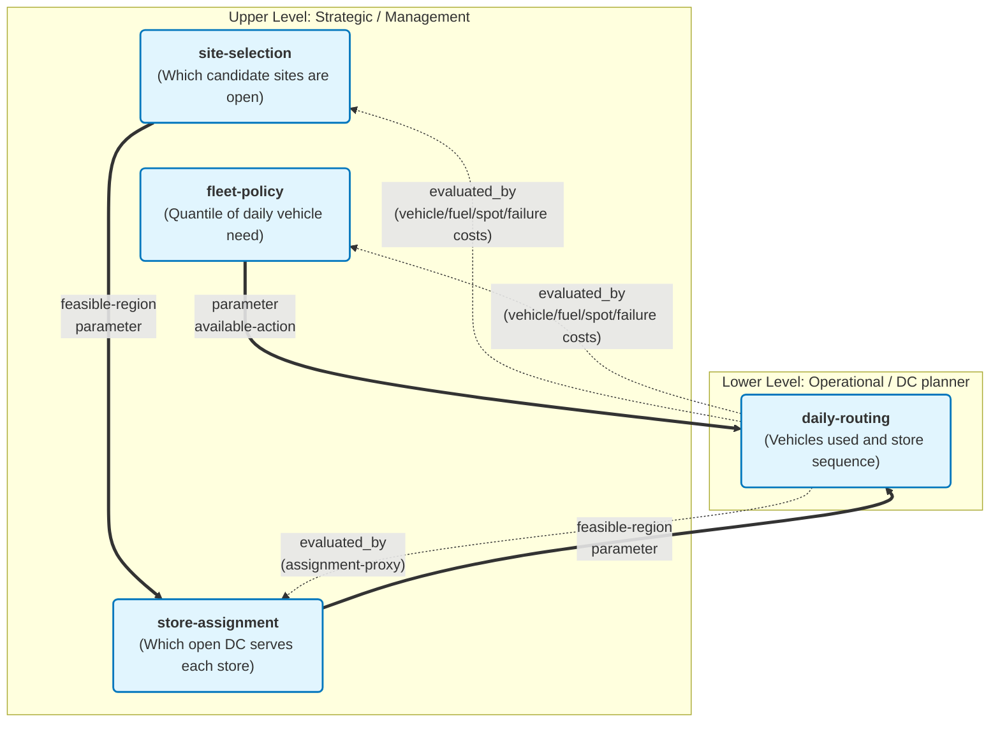

# Problem Definition: Distribution-Centre Network Redesign for Dasol Retail

**IE437 Midterm Project · Distribution-Centre Network Redesign — Formulating and Solving a Hierarchical Decision**

Author / student ID: [entry]  
Date / version: 2026-10-28 · v0.2 (Sections 1–4 drafted before any code; Sections 5–7 pending)  
Summary: TBD — to be written after the experiments (recommended number of DCs, estimated saving and its uncertainty, the one simplification that matters most).  
Files: `problem-definition.md`, `code/`, `demo.html` or the local app in `code/`, `proposal.html`  
LLM tools and use: Claude (Anthropic, Sonnet 5.5), 2026-10-27 — structuring the problem (boundary, decisions, dependencies, classification) and drafting Sections 1–4 (2026-10-27 and 2026-10-28; Section 3 external facts checked by web search, sources cited beside the claims). Assessments of its suggestions are recorded in Section 7 (pending).

Marking: `[ASSUMPTION]` = assumption; `TBD` = unresolved fact (carried to the Section 3 table); `N/A — reason` = inapplicable.

## 1. Decision, Scope & Problem Structure

**Business need.** Dasol Retail (fictional) serves about 10,000 convenience stores from 12 distribution centres (DCs). The store-to-DC assignment was fixed long ago, and several DC leases expire in sequence over the coming years. Management wants to know how many DCs to run and where, and what evidence supports the answer.

> Strategy & Planning, with management approval, uses the posterior predictive of store demand, road distances, candidate sites and cost parameters, once now (before the leases expire), to decide how many DCs to operate, at which sites, which stores each serves and under what fleet policy, in order to minimise total monthly cost (DC fixed cost, vehicles, fuel, spot trucks, service failures) while at least 98% of a day's deliveries arrive before 12:00.

### The four statements

| Statement | Level | Decision or component it concerns | Consequence for comparison |
|---|---|---|---|
| Strategy & Planning: "Cut the DCs from twelve to eight and lease and staff costs fall sharply." | **Evaluation of a decision** (one term only) | `site-selection` at k = 8; component `dc-fixed-cost` | True by construction for one cost term (fixed cost is linear in the number of open sites). It says nothing about total cost, so it cannot be compared with anything until the other terms are added. Same unit as Delivery Operations: KRW per month. |
| Delivery Operations: "Fewer DCs means longer routes, more vehicles; it may end up costing more." | **Evaluation of a decision** (the complementary terms), stated as a hypothesis about sign and size | `site-selection` → `store-assignment` → `daily-routing`; components `vehicle-fixed-cost`, `fuel-cost`, `spot-hire-cost`, `failure-cost` | Directly commensurable with Strategy & Planning: both are terms of the same total monthly cost `E(k)`. Neither claim is decided alone; only their sum over k (the sweep) answers whether the saving is outweighed. |
| Data Team: "The volume-weighted centre of gravity is the optimal site; it takes minutes." | **Method for taking a decision** (candidate generation, the cheap criterion `G`) carrying an unverified validity claim ("optimal") | `site-selection`, via `G` | A method is judged by what the full evaluation `E` says about its output, not by its own score: prediction quality (how well `G` predicts `E`) and decision quality (how much the `G`-best candidate loses under `E`). It is compared with other generators and selection rules at the same budget, not with the cost claims. It does not choose k, and ignores capacity bounds, assignment, vehicle limits and the window. |
| Field Manager: "The centre of gravity may land across the river; trucks drive to the bridge." | **Claim about the validity of a model** (the distance component) | Road distances `l_uv` feeding `fuel-cost`, `route-limits`, `noon-share`, `pair-eligibility`, `assignment-proxy` and `G` | Not a cost and not a decision, so it has no common scale with the other three. It is a validity condition on all of them: tested by the calibration error of distances against road values and by the `G`–`E` gap. It also supports restricting sites to leasable candidates and computing `G` on road rather than map distance. |

**Consequence.** Two statements (Strategy & Planning, Delivery Operations) are evaluations on one scale (KRW per month) and combine into `E(k)`. The Data Team's statement is a method, ranked only through `E`. The Field Manager's statement is a validity claim about an input of all the others and is checked, not summed.

### Boundary

- **One decision problem (upper):** one network redesign chosen now for a steady-state planning horizon. Every current site can be kept or given up and every candidate site can be leased; the 12 current sites are themselves candidates. Demand is represented by sampled days from the posterior predictive (Section 3).
- **One decision problem (lower):** one DC's delivery plan for one day, solved after that day's orders are known (orders by the evening cutoff, routes planned the evening before).
- **Excluded, with consequences:**
  - The sequence of lease expiries (an extension). The result is a one-shot design and ignores transition cost and ordering. A sequential version would be Stateful.
  - The fresh-food second wave (out of scope per brief). Fleet need and kilometres are understated if it shares vehicles.
  - Multiple trips per vehicle, driver breaks, time-of-day traffic, dock congestion, stock or backlog carried between days (details in 2a).
  - Opening and closing of stores during the horizon: the store set is fixed.
  - Transition cost of closing or opening a DC. The recommendation is not a migration plan.
- **Current practice versus constructed baseline.** The company's actual practice (12 DCs, historical assignment, experience-based routes) is unknown here; no real data exist (`TBD`). The **baseline** is constructed: the 12 generated current sites with the generated historical assignment, scored by the same `E`, the same sampled days and the same routing method as every candidate. The baseline is exempt from the capacity bounds. A second reference, the same 12 sites with the assignment re-solved, separates the saving from re-assignment from the saving from changing the network.

### Decisions and dependencies

| Decision ID | What is chosen | Level | Approved by | How it is handled in the prototype |
|---|---|---|---|---|
| `site-selection` | Which candidate sites are open: set `S`, with `k = card(S)` | Upper | Management (proposed by Strategy & Planning) | Searched under budget `B` |
| `store-assignment` | Which open DC serves each store | Upper | Management | Re-solved inside every evaluation as a capacitated assignment LP (rationale in 2b) |
| `fleet-policy` | The quantile `q` of daily vehicle need that fixes owned vehicles per DC | Upper (candidate attribute) | Management / Delivery Operations | `q = 2/3` default; owned fleet `N_j` is derived by the rule `fleet-rule` |
| `daily-routing` | For one DC and one day: vehicles used and the store sequence of each | Lower | DC planner (in reality; the prototype computes it) | Heuristic solve (method in Section 4) |

Not decisions (supporting analyses): the demand model and its posterior predictive, distance lookup and its calibration, the cheap criterion `G`, the sweep over k, the surrogate and acquisition rule, and the sampled-day draws. Prediction and simulation alone do not decide anything; the decision they support is `site-selection`.

**Dependencies** (`parent → child: what changes`):

```text
site-selection → store-assignment : feasible-region (stores may go only to open sites),
                                    parameter (per-site min/max store bounds)
store-assignment → daily-routing  : feasible-region (the store set of DC j),
                                    parameter (n_j, demand vector, distance sub-matrix, the 2% noon budget)
fleet-policy → daily-routing      : parameter (owned fleet N_j = threshold above which spot trucks are paid),
                                    available-action (vehicles free of charge)
site-selection — fleet-policy     : no directed dependency (chosen together in one candidate, same level)
```

**Evaluation relations** (written separately from dependencies):

```yaml
- id: dc-fixed-cost
  decision: site-selection
  evaluated_by: none          # closed form
- id: vehicle-fixed-cost, fuel-cost, spot-hire-cost, failure-cost
  decision: site-selection, fleet-policy   # cost of the candidate (S, q)
  evaluated_by: daily-routing # run on every DC in S over the sampled days
- id: assignment-proxy
  decision: store-assignment
  evaluated_by: daily-routing # the distance proxy is judged by the routes it produces
```

The parent changes the child's problem (dependencies); the child supplies an evaluation of the parent (`evaluated_by`). Receiving that evaluation is not by itself Feedback.

### Classification

| Object | Property | Classification (or unresolved status) | Structural evidence or question to resolve |
|---|---|---|---|
| Decision dependency graph | Decision Structure | **Hierarchical** | Three directed edges, each changing the child's feasible region, parameter or available action (see Dependencies). Multiple decisions alone would not make it hierarchical; the edges do. |
| `site-selection` | State Structure | Stateless | One design chosen now; no state carried between decision epochs; no State-transition component. The lease sequence is excluded; including it would add a state (open DCs, remaining leases). Sampled demand days are draws of a parameter, not a state. |
| `site-selection` | Information Structure | Open-loop | Chosen once from information available now. Basis: `operational-requirement` (leases fix the network for years). The surrogate search reads the results of its own earlier evaluations; this is the algorithm using its logged evaluations, not newly observed future information. |
| `store-assignment` | State Structure | Stateless | One assignment for the horizon; no transition. |
| `store-assignment` | Information Structure | Open-loop | Fixed long-term (the existing assignment has barely changed). Basis: `operational-requirement`. Daily re-assignment of stores between DCs is excluded (`design-decision`). |
| `fleet-policy` | State Structure | Stateless | One quantile policy; no transition. |
| `fleet-policy` | Information Structure | Open-loop | Owned fleet is fixed before any day's demand is known. Spot hiring is the daily reaction and belongs to `daily-routing`. Basis: `operational-requirement`. |
| `daily-routing` | State Structure | Stateless `[ASSUMPTION]` | Load and arrival-time recursions are relations inside one plan, not transitions between decision epochs. Assumes no carry-over of unmet demand, stock or vehicle availability between days. Confirm with Delivery Operations (`TBD`, Section 3); if carry-over matters, this becomes Stateful. |
| `daily-routing` | Information Structure | Open-loop | The day's orders are known when routes are planned; travel times are deterministic in the model; the sequence is fixed before departure. Basis: `operational-requirement` (routes planned the evening before). In-day re-routing is excluded (`design-decision`); it would be Feedback. |



**Information timing across levels.** The upper decisions know only the distribution of demand (posterior predictive). Demand for day d is revealed to the lower level when its problem begins. This is a difference in what each problem knows, not Feedback inside either. `[ASSUMPTION]` If the boundary were redrawn as one problem "network plus a policy for daily reaction to demand", routing would be a recourse and the whole problem would be Feedback; the two-problem boundary above is a `design-decision`, chosen because the two decisions are taken by different people at different times.

**Execution is separate.** In reality `daily-routing` runs every evening; in the prototype it runs on sampled days. Daily re-execution of an independent problem does not make it Feedback, and the number of solver calls is not a state.

## 2. Computable Problem

### 2a · The lower level — one DC's daily operation

**Given** (for DC `j` and day `d`): the stores `I` assigned to `j` (`n = card(I)`); demand `q_i` in roll cages for each store on that day (a sampled day); road distance `l_uv` (km) between nodes (node 0 is the DC), symmetric `[ASSUMPTION]`; travel time `t_uv = 60·l_uv / v` minutes with `v = 35 km/h`; stop time `s = 15 min`; departure `τ0 = 05:00` for all vehicles `[ASSUMPTION]` (the brief allows 04:00–07:00; `TBD` with Delivery Operations); owned fleet `N` (a parameter passed down; `N = 0` in the sizing pass, see 2b); limits `Q = 48` cages, `M = 25` stops, `L = 250` km, route duration `T = 10 h` `[ASSUMPTION]` (loading treated as outside this duration; if loading counts inside the 10-h shift, `T` falls to about 9 h; `TBD`); noon budget `α = 2%`; rates `c_f = 350` KRW/km, `c_s = 550,000` KRW per spot truck-day, `p_14 = 120,000` KRW per delivery after 14:00, `p_so = 500,000` KRW per undelivered store; optional spot-truck availability cap `κ` (base run: no cap, `TBD`).

**Route set.** `R` is the set of feasible routes `r = (0, i_1, …, i_m, 0)`, each satisfying `Σ q_i ≤ Q`, `m ≤ M`, `len(r) ≤ L`, `duration(r) ≤ T`. Arrival at the h-th stop is `a_{i_h} = τ0 + t_{0,i_1} + Σ_{g<h} (s + t_{i_g,i_{g+1}})` (minutes since midnight). Let `n12(r)` and `n14(r)` count stops with `a > 12:00` and `a > 14:00`.

**Decided.** `λ_r ∈ {0,1}` (route `r` is driven; one vehicle each), `u_i ∈ {0,1}` (store `i` not delivered), `σ ≥ 0` (spot trucks hired). The vehicles used are `V = Σ_r λ_r`.

**Objective** (minimise daily operating cost, KRW):

```text
min  c_f · Σ_r len(r) λ_r  +  c_s · σ  +  p_14 · Σ_r n14(r) λ_r  +  p_so · Σ_i u_i
s.t. Σ_{r ∋ i} λ_r + u_i = 1          for every store i       (served once or stocked out)
     σ ≥ Σ_r λ_r − N,   σ ≥ 0          (and σ ≤ κ if a cap applies)
     Σ_r n12(r) λ_r ≤ floor(α · n)     (at most 2% of the DC's stores arrive after 12:00)
     λ_r, u_i ∈ {0,1}
```

This is a set-partitioning vehicle-routing problem with side constraints (capacity, stops, distance, duration and a time-window budget). It is combinatorial (NP-hard), so the solution method is a heuristic chosen in Section 4. Cost per solve and measured accuracy: `TBD` (Section 4).

**Modelled and omitted.**

| Feature | Treatment | Reason / consequence |
|---|---|---|
| Load, stops, distance, duration limits | Modelled (hard) | Core of the brief. With τ0 = 05:00 the clock (7 h to noon, 15 min per stop) binds before the 25-stop limit; which limit binds is itself a result to report. |
| Stop time and constant road speed | Modelled (15 min, 35 km/h) | Brief's defaults; 30–45 km/h tested as sensitivity. |
| Single vehicle type, one trip per vehicle | Modelled | A second trip would lower vehicles needed in dense territories; fleet need is overstated there. Omitted for tractability. |
| Driver breaks | Omitted | Would shorten feasible routes (understates vehicles). Not in the brief. |
| Time-of-day traffic | Omitted | Peak slowdowns flatter long routes; speed sensitivity partly covers it. |
| Loading-dock congestion, staggered departures | Omitted (single departure time) | Staggering would let long routes leave earlier; omission is conservative for them. |
| Empty-cage collection | Omitted | No load or time effect assumed. |
| Fresh-food second wave | Out of scope | Per brief. |
| Carry-over between days | Omitted `[ASSUMPTION]` | Makes `daily-routing` Stateless; to confirm. |

**How the delivery window enters.** Hybrid, stated explicitly. The 98%-before-noon requirement is a **hard side constraint per DC-day** (`α = 2%`), which is a conservative sufficient condition for the chain-wide 98% (`TBD`: whether the company means per DC or chain-wide). Delivery after 14:00 and non-delivery are **penalised** (soft, 120,000 and 500,000 KRW). The realised chain-level share before noon is reported for every network. Because the noon constraint is on the routes, a larger territory needs more vehicles, which is the mechanism behind Delivery Operations' claim.

**One solve returns upward** (per DC-day): vehicles needed `V`, kilometres, stops per route, `n12`, `n14`, undelivered stores `u`, spot trucks `σ`, and the operating cost.

### 2b · The connection

**Passes down:** the open set `S`, the fleet policy `q`, and the sampled demand days `D` (posterior-predictive draws, shared across all candidates and the baseline as common random numbers, so differences are not sampling noise). The assignment `A_j` is derived inside the evaluation from `S`.

**Passes up:** per DC-day `V`, km, `n12`, `n14`, `u`, `σ`; aggregated into expected monthly operating cost, owned vehicles and realised service level.

**One evaluation `E(S, q)`:**

1. Solve the assignment LP for `S` (reject `S` with the reason if infeasible).
2. **Sizing pass:** for each `j ∈ S` and `d ∈ D`, solve the lower level with `N = 0` (every vehicle priced as a spot truck, so vehicles are minimised first) and record `V_{j,d}`.
3. `N_j = ceil(Q_q({V_{j,d}}))`, the `q`-quantile of daily need (`fleet-rule`; `q = 2/3` default), weighted by the sampled-day weights `ω_d` (Section 3.4).
4. **Accounting:** spot trucks `σ_{j,d} = max(0, V_{j,d} − N_j)`, with the routes of step 2 frozen `[ASSUMPTION]`. This ignores that free owned vehicles could shorten routes, so cost is slightly overstated; to be checked on a small instance (Section 4).
5. `E = F(S) + c_v·ΣN_j + D_m · Σ_d ω_d Σ_j [c_f·km + c_s·σ + p_14·n14 + p_so·u]`, with `D_m = 30.4` days per month `[ASSUMPTION]` and day weights `ω_d` summing to 1 (equal when dates are drawn uniformly; stratified weights in Section 3.4).

**Cost of one evaluation:** `k · card(D)` lower-level solves plus one assignment LP. With 7 sampled days, k = 8 gives 56 solves. With 28 days, 224; the 14 held-out days add 112; the baseline costs 12 × (28 + 14) = 504 solves. The cost per solve is `TBD` (Section 4).

**Where demand uncertainty enters.** Only through `D`, in the lower level: fleet size (an order statistic) and spot hiring are not linear in demand, so an average day would understate both. Sampled days include a chain-wide calendar draw, so costs are correlated across DCs. **Averaged away (simplification):** `store-assignment` and `G` use posterior-mean volumes `w_i`; this goes in the Section 4 table. The fleet is sized and scored on the same sampled days, which is optimistic for spot cost; the held-out days measure the effect.

**Place of the assignment.** It is a decision (`store-assignment`) but **not part of the searched candidate**; it is re-solved inside each evaluation. Reasons: (i) for fixed `S` it is a transportation problem with bounds (an LP with integral vertices), exact and fast; (ii) putting about 2,000 store-to-DC choices into the candidate would give a search space a few dozen evaluations cannot learn; (iii) every candidate then gets a consistent, reproducible assignment. Cost: the LP minimises a distance proxy (`assignment-proxy`), not route cost, so compact routing and the window can be missed; this feeds the `G`–`E` gap and is a candidate check for Section 4. The baseline keeps its historical assignment (a fact of the operation), hence the second reference with re-solved assignment.

### 2c · The upper level — how many DCs, and where

**Variables and domains.** `y_j ∈ {0,1}` for each candidate site `j ∈ C` (`card(C)` about 40–80, including the 12 current sites); `k = Σ y_j`; `x_ij ∈ {0,1}` (store `i` served by `j`; derived by the LP, not searched); `q` (fleet quantile, base value 2/3). A **candidate** is `(S, q)`.

**Objective and constraints:**

```text
min over (y, q):  E(y, q) = Σ_j f_j y_j  +  c_v Σ_j N_j(y, q)  +  D_m · E_d [ Σ_j Φ_j(A_j(y), d, N_j) ]
                  where Φ_j is the optimal value of the lower level (2a) for DC j on day d

s.t. Σ_j x_ij = 1                         every store assigned once
     x_ij ≤ y_j,  x_ij ≤ elig_ij          only open sites; eligibility (a single-store route meets noon and the km/duration limits)
     min_j · y_j ≤ Σ_i x_ij ≤ max_j · y_j  store-count bounds per open DC (new designs only; baseline exempt)
     realised share of deliveries before 12:00 ≥ 98%   (implied by the per-DC-day noon budget; reported)
```

**Feasible range of k.** With `n` stores and the default bounds (500–1,400 stores per DC, scaled in proportion if thinned), `ceil(n/1,400) ≤ k ≤ floor(n/500)`. For n = 10,000 (and for 2,000 with bounds 100–280) this gives **8 ≤ k ≤ 20**. So Strategy & Planning's proposal of 8 is the smallest feasible network under these bounds, with every DC near its maximum. Site-specific `max_stores` can raise the minimum. The sweep covers this range; k = 8 is the natural boundary test case.

**Convex or linear, and combinatorial.**

- *Linear:* the fixed-cost term; the assignment for fixed `S` (transportation LP, exact); the LP relaxation of the capacitated p-median, which gives a lower bound for `G`.
- *Convex:* the one-site weighted-distance (Weber) problem under map distance. It is not convex on road distance, which is the Field Manager's point.
- *Combinatorial:* the choice of `S` (about 2.6 × 10⁹ subsets for k = 8 of 60 sites); the fleet quantile (an order statistic); and `Φ_j`, an NP-hard routing problem with no closed form.
- *Implication:* `E` is a black box, so no exact optimum of `E` is available. Exact solution is possible only for `G` (capacitated p-median as a MIP for each k) and for the lower level on small instances (to measure heuristic accuracy). The upper level is therefore searched under a budget `B` (Section 4).

### I/O schema

| Input / output | Table or parameter | Field | Type / unit | Meaning; one row is … |
|---|---|---|---|---|
| Input | `stores` | `store_id`, `region`, `lat`, `lon`, `store_type`, `opened_on`, `closed_on`, `current_dc_id` | text; text; decimal degrees; enum (residential / office / mixed / roadside); date; date or null; text | one store (all stores, or the thinned fraction) |
| Input | `demand_history` | `store_id`, `date`, `cages_ordered` | text; date; integer (roll cages) | one store on one day, last 12 months; feeds the demand model |
| Input | `dcs` | `dc_id`, `lat`, `lon`, `lease_expires_on`, `monthly_fixed_cost`, `max_stores`, `min_stores` | text; degrees; date; KRW; integer | one current DC (12 rows) |
| Input | `candidate_sites` | `site_id`, `lat`, `lon`, `monthly_fixed_cost`, `max_stores` | text; degrees; KRW; integer | one leasable site, 40–80, including the 12 current ones |
| Input | `cost_parameters` | name, value, unit | fuel 350 KRW/km; vehicle 5.5 M KRW/month; spot 550,000 KRW/day; late 120,000 KRW; stock-out 500,000 KRW; capacity 48 cages | one parameter |
| Input | model parameters | `v`, `s`, `τ0`, `T`, `M`, `L`, `α`, `q`, `D_m`, `κ`, thinning fraction, sampled-day counts (7 / 28 / 14), `B` (default 40), seeds | km/h; min; clock time; h; count; km; share; share; days; count; fraction; counts; count; integer | one scalar setting |
| Input | `road_distance` cache (ours) | `from_id`, `to_id`, `km`, `source` | text; text; km; enum (engine / calibrated detour) | one point pair; source, version, extract date stated in Section 3 |
| Output | recommended network | `site_id` list, `k`, `store_id → dc_id`, `N_j` per DC | text list; integer; text pairs; integer | the recommended `S`, its assignment and owned vehicles |
| Output | cost breakdown | component (the five cost components plus total), `mean`, interval on sampled days, interval on held-out days | text; KRW/month; KRW/month | one cost component of one network (baseline and recommended) |
| Output | service level | realised share before 12:00, share after 14:00, undelivered | share per network | one network |
| Output | evaluation log | `eval_id`, `S`, `q`, `k`, `G`, `E`, selection rule, seed, days used | integer; text list; number; KRW/month; text | one full evaluation (every one of the `B`) |
| Output | sweep | `k`, best `E`, `F`, operating cost | integer; KRW/month | one number of DCs |
| Output | `G`-versus-`E` table | candidate, `G`, `E` | KRW/month | one evaluated candidate |
| Output | lower-level run | route id, store sequence, km, stops, arrival times, late flags, vehicles, spot | mixed | one route on one DC-day |
| Output (baseline history) | `deliveries`, `vehicle_days`, `spot_hires` | as in the brief's Section 2.5 | as in the brief | produced by running our own lower level on the current network, and labelled so |

### The two criteria

- **Full evaluation `E(S, q)`:** fixed cost + vehicle cost + `D_m` × the `ω_d`-weighted mean over sampled days of [fuel + spot + failure cost], with the assignment re-solved, the lower level solved for every DC on every day, and the fleet from the quantile rule (procedure in 2b). Expensive: `k · card(D)` routing solves per candidate; with the real routing system it would take hours.
- **Generation criterion `G(S) = F(S) + λ · P(S)`:** `P(S)` is the capacitated p-median assignment cost on **road** distances weighted by posterior-mean volume (the `assignment-proxy` value), and `λ` (KRW per cage-km per month) is a scale constant, calibrated on the evaluated candidates (Section 4). Cheap: one LP, or a MIP for the G-best set for each k.
- **What `G` ignores:** route sequencing (star distance replaces tour length), the 25-stop / 250-km / 48-cage limits and therefore the vehicle count, the stop time and the noon window, the fleet quantile and spot hiring, penalties for failures, demand variability (it uses means), and that the assignment minimises distance rather than route cost.

### Components

Roles and Models are kept separate (reference, Section 3). There is **no State-transition component** (`N/A — all decisions Stateless`) and **no Simulation component**: the sampled-day evaluation is a Monte Carlo average of a parameter (demand), and arrival times follow from an explicit recursion, not from executing system time and events. **No evaluation component is Data-driven.** The demand model is a supporting analysis that supplies parameters; the detour calibration supplies distance parameters. Neither is a learned relation from context and decision to outcome.

| Component ID | Decision ID | Role: Cost / Constraint / State-transition | Model: Formulation / Simulation / Data-driven | Definition, units, and evidence / assumption / unknown |
|---|---|---|---|---|
| `dc-fixed-cost` | `site-selection` | Cost (minimise) | Formulation | `F(S) = Σ_{j∈S} f_j`, KRW/month; default 150 M per DC, scaled with thinning; site-specific, higher in the capital region (fictional). |
| `vehicle-fixed-cost` | `fleet-policy` | Cost (minimise) | Formulation | `c_v · Σ_j N_j`, KRW/month; 5.5 M per vehicle including driver. |
| `fleet-rule` | `fleet-policy` | Constraint | Formulation | `N_j = ceil(Q_q({V_{j,d}}))` over sampled days; `q = 2/3` default. Uses sizing-pass outputs from `daily-routing`; an in-sample estimate. |
| `fuel-cost` | `daily-routing` | Cost (minimise) | Formulation | `c_f · Σ_r len(r) λ_r`, KRW/day; 350 KRW/km on cached road distances. |
| `spot-hire-cost` | `daily-routing` | Cost (minimise) | Formulation | `c_s · max(0, V − N)`, KRW/day; 550,000 KRW per truck-day; cap `κ` `TBD`. |
| `failure-cost` | `daily-routing` | Cost (minimise) | Formulation | `p_14 · (deliveries after 14:00) + p_so · (undelivered)`, KRW/day. |
| `load-limit` | `daily-routing` | Constraint (hard) | Formulation | `Σ q_i ≤ 48` cages per route; `q_i` from the posterior predictive. |
| `route-limits` | `daily-routing` | Constraint (hard) | Formulation | At most 25 stops, 250 km, and duration `≤ T`; stop time 15 min, speed 35 km/h. |
| `noon-share` | `daily-routing` | Constraint (hard) | Formulation | At most `floor(0.02 n)` stores arrive after 12:00 per DC-day; arrivals from the recursion in 2a. |
| `cover-once` | `daily-routing` | Constraint (hard) | Formulation | Each store is visited once or counted as undelivered. |
| `capacity-bounds` | `store-assignment` | Constraint (hard) | Formulation | Store count of each open DC between `min_j` and `max_j` (scaled if thinned); baseline exempt. |
| `pair-eligibility` | `store-assignment` | Constraint (hard) | Formulation | Store `i` may go to DC `j` only if a single-store route meets noon and the km/duration limits. |
| `assignment-proxy` | `store-assignment` | Cost (minimise) | Formulation | `Σ w_i · l_{i,j(i)}`, cage-km/day, posterior-mean volume `w_i`; a proxy for routing cost, judged by `daily-routing`. |

**Where the demand model supplies parameters:** sampled `q_i^d` to `load-limit` (and so to vehicles, kilometres, `fleet-rule` and the spot and failure costs); posterior-mean `w_i` to `assignment-proxy` and `G`. **Distances** (`l_uv`, `t_uv`) supply `fuel-cost`, `route-limits`, `noon-share`, `pair-eligibility`, `assignment-proxy` and `G`.

**Hard constraints versus preferences.** Hard: `capacity-bounds` (new designs only), `pair-eligibility`, `load-limit`, `route-limits`, `noon-share`, `cover-once`. Priced preferences: spot trucks, deliveries after 14:00, undelivered stores.

**Infeasible inputs** are reported, never silently repaired:

- A set `S` with `Σ max_j < n` or `Σ min_j > n`, or in which some store is eligible for no open DC, is rejected with the reason (stores or bounds responsible).
- A store demand above 48 cages raises a data error (not expected at the default mean of about 2.2 cages).
- A day the fleet cannot cover (spot cap `κ` binding) yields undelivered stores priced at `p_so`, and the result is flagged as not meeting the service level.
- Duplicate or missing IDs, non-finite coordinates or distances absent from the cache stop the run with a field-specific message.

**Follow-up questions (reference, Section 5).** *Stateful:* N/A — all decisions Stateless. *Feedback:* N/A — all decisions Open-loop. *Formulation:* answered above (variables, objective, hard and soft constraints, parameters, feasibility, infeasible-input handling). *Simulation:* N/A — no Simulation component. *Data-driven:* N/A for evaluation components (demand model and distance calibration are in Section 3). *Hierarchical:* parent and child decisions, what is passed or changed, and `evaluated_by` are in Section 1 and 2b; no feedback relationship is claimed.

## 3. Information & Uncertainty

**Status.** No code has been written or run as of v0.2. Everything below is a specification of what will be generated and measured. Numbers are one of: *design value* (a choice I make), *illustrative arithmetic* (checkable by hand, not a result), or `TBD` (to be measured). There are no measured results yet. Section references "brief 2.5" and "brief 2.7" follow the template's wording for the distance routes and for thinning the chain.

### 3.1 The instantiated data

All tables are generated from one master seed (`SEED = 437`) split into independent sub-seeds with `numpy.random.SeedSequence.spawn` (data, demand history, distances sample, planning days, search, control). Geography is South Korea's mainland `[ASSUMPTION]` (the brief's costs are in KRW); Jeju is excluded because it has no road link to the mainland. Every number below is fictional unless a source is cited.

| Table | How generated (distribution, parameters, seed) | Real-world property reflected |
|---|---|---|
| `stores` (10,000 generated, 1-in-5 kept) | Location mixture: about 20 urban clusters (weights proportional to metro population, scatter 6–15 km by city size) plus a 10% rural component. The capital-region clusters are weighted to sum to about 51%, matching the share of the national population living there on about 12% of the area ([Korea Business Review](https://www.koreabizreview.com/en/articles/kbr-legacy-7797)). Points that cannot be snapped to a road within 500 m are rejected. Types: residential 45%, office 20%, mixed 25%, roadside 10%, with office and mixed more likely near city cores and roadside in the rural component. About 4% of stores opened and 2% closed within the last 12 months; the rest opened 1–15 years ago. `current_dc_id` is the nearest current DC. Thinning keeps a stratified 1-in-5 sample by cluster (about 2,000 stores). | Heavy concentration around one metropolis, many mid-size cities, a sparse rural remainder, rivers that force detours, and a few short-history stores. |
| `demand_history` (12 months to 2026-10-27) | Store daily mean `θ_i` (cages per day): log-normal around the type mean, sigma 0.5, clipped to [0.5, 6], chain mean about 2.2 (design values). Daily demand `y_it ~ NegBin` with mean `θ_i · e_{g,t}` and day-level overdispersion (CV 0.25 for the daily shock). Calendar factor `e_{g,t} = ω_{g,weekday} · σ_month · η_holiday`: residential and roadside higher on weekends, office lower; summer peak of about +15%; holiday and pre-holiday spikes of about ×1.2–1.5 on about 15 days a year (dates from the official public-holiday list for the window, cited when generated, `TBD`). All factors are normalised to mean 1. | Store-to-store heterogeneity, weekday patterns that differ by store type, a seasonal cycle, chain-wide holiday spikes, and noise beyond Poisson. |
| `dcs` (12 current) | Chosen from the candidate sites by a capacitated 12-median on map distance for the store set of about 15 years ago (stores older than 5 years), then three DCs are moved to another candidate within 30 km. Monthly fixed cost 30 M KRW × site multiplier (see below); `max_stores` 280, `min_stores` 100; `lease_expires_on` spread over the next 1–6 years. | A chain that grew in stages: sensible but not optimal, with lock-in. This avoids a strawman baseline that is too good or too bad. |
| `candidate_sites` (60, including the 12 current) | Sampled from OSM motorway junctions that have industrial land use within 5 km (via `osmium` on the extract below), spread by farthest-point sampling weighted by store density, at least two per macro-region. Fixed cost 30 M KRW × multiplier (capital region 1.3, other metropolitan cities 1.1, elsewhere 0.9, ±10% noise). `max_stores` 280 for three quarters of the sites and 200 for the rest; `min_stores` 100. If a junction/industrial join is too sparse, fall back to road-snapped points near store density and label them as synthetic. | Logistics sites sit near motorway access and industrial zones; land and labour cost more near the capital; some sites are smaller. |
| `cost_parameters` | As given in the brief (fuel 350 KRW/km, vehicle 5.5 M KRW/month, spot 550,000 KRW/day, late 120,000 KRW, stock-out 500,000 KRW, 48 cages). The fixed cost (150 M KRW per DC at full scale) and the store-count bounds (500–1,400) are scaled by the thinning fraction 0.2 to 30 M and 100–280. Vehicle, fuel, spot and penalty rates are not scaled. | Per-unit costs do not change when I sample fewer stores. |
| `deliveries`, `vehicle_days`, `spot_hires` | Not drawn independently. They are produced by running my own lower level on the baseline network over simulated history days and labelled as model output. | Gives the baseline a consistent, reproducible history. |

**Scale of the instance and what changes at full scale.** The instance has about 2,000 stores, 12 current DCs and 60 candidate sites; each DC serves 100–280 stores. At full scale n = 10,000 and each DC serves 500–1,400. Illustrative arithmetic: store–store pairs within a fixed radius grow about 25× (5× the stores at 5× the density), site–store pairs 5×, each lower-level solve involves about 5× more stores, and kilometres per store should fall by about `√5 ≈ 2.2` (spacing shrinks with the square root of density). The feasible range of k does not change (`ceil(n/280) = ceil(2,000/280) = 8` and `floor(2,000/100) = 20`, the same as at full scale). With 200-store sites, k = 8 is feasible only if at most three of the eight open sites are small (`2,240 − 80s ≥ 2,000` gives `s ≤ 3`, if n = 2,000 exactly). Solve time per DC-day at full scale is `TBD`; it is expected to grow faster than linearly in n, which is why the full run uses the thinned instance.

### 3.2 Distances

**Route taken (brief 2.5): a mixture.**

- **Engine values** from a self-hosted OSRM for (a) every candidate-site × store pair (about 60 × 2,000 = 120,000 pairs) and (b) every store–store pair within `R = 60` km (my choice, so that nearly all legs of a route are covered).
- **A calibrated detour model** (haversine distance × a ratio) only for the few store–store legs beyond `R`.

**Why self-hosted.** The public demo server is restricted to reasonable non-commercial use at no more than one request per second and gives no guarantees ([OSRM demo-server page](https://github.com/Project-OSRM/osrm-backend/wiki/Demo-server)). Arithmetic: 120,000 single-pair requests at 1 per second would take about 33 hours.

| Item | Specification |
|---|---|
| Road data | OSM extract of South Korea from Geofabrik (`asia/south-korea-latest.osm.pbf`), normally updated daily ([Geofabrik](https://download.geofabrik.de); [South Korea extract page](https://download.geofabrik.de/asia/south-korea.html)). The download date and file hash are written to `code/cache/osrm_meta.json` at build time (`TBD`). |
| Engine and version | OSRM `osrm-backend`, built with `osrm-extract -p car.lua`, `osrm-partition`, `osrm-customize`, served with `osrm-routed --algorithm mld` ([OSRM README](https://github.com/Project-OSRM/osrm-backend)). The releases page lists v5.27.1 as the latest listed release at the time of searching ([releases](https://www.github.com/Project-OSRM/osrm-backend/releases)); the version actually installed is pinned at build and recorded in `osrm_meta.json` (`TBD`). |
| Vehicle profile | The default car profile (`car.lua`). Only its **distance** is used; time is my own constant speed (35 km/h) plus stop time. `[ASSUMPTION]` Truck restrictions (height, weight, banned roads) are not modelled, so distances can be slightly short for some legs. |
| Resolution | Exact store and site coordinates, snapped to the nearest road by the engine; the snap distance is stored, and the 500 m rejection rule is applied at generation. No grid aggregation. |
| Pairs computed | About 120,000 site–store pairs and a few hundred thousand store–store pairs within `R`, via the engine's table service in batches. The exact count and run time are `TBD`. Distances are assumed symmetric `[ASSUMPTION]` (one-way streets ignored). |
| Cache | `code/cache/road_distance.parquet`, one row per unordered pair `(from_id, to_id, km, source)` with `source` either `engine` or `detour`, plus `osrm_meta.json`. The experiments read only the cache. |
| Calibration of the detour model | 1,000 random pairs queried from the engine, stratified by map-distance band (0–10, 10–30, 30–60, 60–150, over 150 km) and by area (capital region, other metropolitan, rural), **including pairs that cross a large river** (the Field Manager's concern). The ratio road/haversine is fitted per band and area on 70% of the sample; mean absolute percentage error and bias are reported on the other 30%. Error on the calibration sample: `TBD` (Not run). |

The calibration sample also produces the distribution of road-to-map ratios, which shows directly whether map distance misrepresents road distance for a given pair (Section 1, Field Manager).

### 3.3 The instance: thinning and placement

- **Fraction kept (brief 2.7):** 1 in 5 (`φ = 0.2`), about 2,000 stores, with a stratified sample by cluster so regional shares are preserved. The reduced run uses `φ = 0.05` (about 500 stores).
- **Scaling:** DC fixed cost and store-count bounds are multiplied by `φ` (see 3.1) so that fixed cost per store and capacity per store stay as at full scale. Vehicle, fuel, spot and penalty rates are unchanged.
- **Stop density:** **one stop per sampled store**; stops are not aggregated. Distortion: with 1/5 of the stores, neighbouring stops are about `√5 ≈ 2.2` times farther apart than in the real chain, and the clock (15 minutes per stop, noon window) allows fewer stops per route in the same area. Both inflate operating cost per store. By reasoning from a continuous approximation (not measured), the part that depends on the number of DCs, the line-haul to the territory divided by stops per route, is inflated more, so **the thinned instance should be biased toward recommending more DCs**; a finding that fewer DCs win would therefore be conservative. This is recorded as a row of the Section 4 table and tested on a denser sub-instance (Check 1).
- **Placing the 12 current DCs and the candidates:** as in 3.1. About half of the current DCs should fall in the capital region, as a result of fitting the store distribution there, not by instruction. Candidates sit near motorway access and industrial land use, where a real chain would look for sites.

### 3.4 The demand model

Per store `i`, store type `g(i)`, day `t`:

```text
y_it | θ_i ~ Poisson(θ_i · e_{g,t})                 (negative-binomial variant if the dispersion check fails)
e_{g,t} = ω_{g,weekday(t)} · σ_{month(t)} · η_{holiday(t)}        calendar effect, mean 1
θ_i ~ Gamma(a_g, b_g)                                prior, mean μ_g = a_g / b_g, squared CV = 1 / a_g
θ_i | history ~ Gamma(a_g + Σ_t y_it, b_g + Σ_t e_{g,t})          update, sums over the days the store was open
planning day d: draw θ_i from the posterior, then y_id ~ Poisson(θ_i · e_{g,d})      posterior predictive
```

- **Calendar effect.** The weekday factors by store type, month factors and holiday factors are estimated **once** for the chain from a Poisson regression with a fixed effect per store on stores with long history. They are then treated as known: their uncertainty is a simplification (Section 4 table).
- **Prior and its strength.** The prior mean `μ_g` and shape `a_g` come from empirical Bayes: method-of-moments on the estimated rates of stores with at least 300 days of history, with the sampling noise removed. `b_g = a_g / μ_g` is the prior's worth in exposure-days. Illustrative arithmetic (not a result): a between-store CV of 0.5 with mean 2.2 gives `a = 4`, `b ≈ 1.8` days, so a store with 14 days of history has a prior weight of `1.8 / (1.8 + 14) ≈ 11%`.
- **Short-history stores.** They stay in the model; the posterior is wider and shrinks toward the type mean. Sensitivity with prior strength ×0.5 and ×2 (planned). New-store ramp-up is not modelled (`TBD`, Section 3.5).
- **Fit check.** Posterior predictive check on the dispersion of daily counts per store. If the variance-to-mean ratio is clearly above 1, the likelihood becomes negative binomial. The generator's day-level overdispersion makes this check informative. Result: `TBD` (Not run).
- **Planning days.** Calendar dates are drawn stratified by (weekday or weekend) × (season) × (holiday class), with weights `ω_d` equal to the stratum's share of the year divided by the number of sampled days in it. Three disjoint sets of dates: **7 days while searching** (`D7`), **28 days for the final comparison** (`D28`), and **14 held-out days** (`H14`) never used before the final saving estimate. A fourth set of 7 days (`D_dev`) is used only for development. Every set uses one independent draw of `θ` and demand per day, and the same days are shared by every candidate and the baseline (common random numbers). The means and quantile in Sections 2b and 2c are weighted by `ω_d`.
- **Where demand enters a cost.** Through the sampled `q_i^d` in `load-limit`, which drives vehicles `V`, kilometres, the fleet quantile and the spot and failure costs; the posterior-mean `w_i` enters `assignment-proxy` and `G`.
- **Sampled-day versus average-day evaluation.** Fleet size (an order statistic) and spot hiring are not linear in demand, so a cost computed once at average demand differs from the average of costs over sampled days (Jensen's inequality: for cost functions with this convex-like kink structure the average-day cost is typically lower). The difference is reported for the recommended network **whatever its size**: evaluate it once with average-day demand and compare it with the `D28` figure (Not run).

### 3.5 Facts, assumptions, unknowns and requests

*Information available at decision time:* the 12-month history to 2026-10-27, road network, cost parameters, site list. *Later outcomes:* realised demand on the sampled days, realised vehicle needs and spot hires; these are used only for evaluation, and `H14` only for the final saving estimate.

| Fact / assumption / unknown or request | Evidence or reason for current treatment | Why it matters | How to confirm or obtain it; priority | Fallback or limit until confirmed |
|---|---|---|---|---|
| The chain, stores, history, costs and sites are fictional and generated | The brief asks for instantiated tables | Every number depends on them | Real tables from the company: store master, 12 months of orders, lease table, site list; high | Results illustrate the method, not company facts |
| Mainland-only geography; Jeju excluded | No road link to the mainland | Stores or sites there would be unservable by road | Confirm the company's coverage; low | Keep excluded |
| Distances are OSRM car-profile road distances, symmetric, without truck restrictions | Free open data; the demo server is not usable at this volume | Banned or restricted roads change route length and feasibility | Delivery Operations: list of roads or areas their vehicles cannot use; recorded km of real routes; high | Report the calibration error; sensitivity on distance ±10% |
| Constant speed 35 km/h and 15-minute stops | The brief's defaults | Time drives the noon window and therefore vehicles | Vehicle telematics: speeds by time of day, stop durations; high | Sensitivity: speed 30 / 35 / 45, stop 10 / 15 / 20 |
| `TBD` Departure time 05:00 for all vehicles; whether loading counts in the 10-hour shift | `[ASSUMPTION]` in Section 2a | Moves the last feasible stop time by hours | Delivery Operations: shift rules, loading times, dock capacity; high | Run both `T = 10 h` and `T = 9 h` |
| `TBD` The 98% target: per DC-day or chain-wide | The brief states the level; enforcement is my choice | A per-DC-day rule is stricter and may overstate vehicles | Strategy & Planning / Delivery Operations: how the service level is contractually measured; medium | Per-DC-day (conservative); report chain-wide share |
| `TBD` Spot-truck availability per DC-day | None; base run has no cap | A cap creates stock-outs and changes the failure cost | Spot-hire records: requests refused; high | No cap in the base run; the failure demo uses a cap |
| `TBD` Carry-over of unmet demand, stock or vehicle availability between days | Assumed none (makes `daily-routing` Stateless) | If present, the problem is Stateful | Delivery Operations; medium | Stateless; flag the claim as conditional |
| Demand follows a Poisson or negative-binomial law around a calendar-adjusted store mean | Typical for counts; check planned | Tails drive fleet quantiles and spot hires | Order history with timestamps and cutoff times; medium | Use the negative-binomial variant if the check fails |
| Calendar effects are shared chain-wide and known after estimation | Standard simplification; the brief suggests it | A wrong effect shifts every day's demand | Re-estimate with a year of real history; medium | Sensitivity on the multipliers ±10% |
| New-store ramp-up is ignored | No data | Short-history stores may sell less than their posterior mean | Opening dates with first-weeks sales; low | Prior-strength sensitivity |
| Lease or exit costs, closure costs and the lease schedule | Not in the instance; excluded (Section 1) | A closure penalty can reverse a cost-saving closure | Real lease contracts with exit terms; high | Report recommendation as steady-state; flag as unpriced |
| Candidate sites are actually available at the stated cost and size | Synthetic sites | The recommended site may not exist | Real estate shortlist with zoning and lease terms; high | Restrict to current sites plus confirmed ones |
| `min_stores` and `max_stores` are hard limits | The brief gives them as bounds | They set the feasible range of k to 8–20 | Delivery Operations: are they engineering limits or soft targets; high | Hard; the range of k is reported with them |
| Baseline is a plausible stand-in for current practice | Constructed (Section 1) | The saving is measured against it | Recorded `deliveries`, `vehicle_days`, `spot_hires` and actual routes; high | Report saving against two references (historical and re-assigned) |
| Thinning distorts operating cost per store | 3.3 reasoning | Could bias k upward | Denser sub-instance (Check 1) | Interpret fewer-DC results as conservative |

**Main uncertainties and how I examine them.** (1) Cost parameters and time parameters: a one-at-a-time sensitivity on fixed cost ±20%, vehicle cost ±20%, speed 30/35/45 km/h, stop time 10/15/20 minutes, demand level ±10%, shift `T = 9 / 10 h`. (2) Distances: engine-only on a sample versus detour model, and the calibration error. (3) Demand: prior-strength sensitivity, dispersion check, average-day versus sampled-day. (4) Thinning: Check 1. (5) Search noise: the random-selection control and the held-out days. For each I record whether the recommended k, or the ranking of the top candidates, changes. All of this is planned and **Not run**.

**When the recommendation should not be trusted.** If any sensitivity above changes the recommended k by more than one, or reorders the top three candidates; if the calibration error of distances is large relative to the cost differences between candidates; if the realised chain-wide share before noon of the recommended network is below 98% on any set of days; if the model's baseline vehicle-days and kilometres differ materially from the company's recorded ones (the first real-data check, Section 6); if the thinning check shows the sweep curve depends on density; or if real demand shows a regime change the history does not contain.

## 4. Alternatives & Selected Approach

**Status.** Nothing in this section is implemented or run. Items are tagged: **P** planned, **I** illustrative arithmetic that can be checked by hand, **R** measured result (none yet).

### 4.1 Approaches

| Approach | Mechanism and required information | Strengths, limitations, and effort | Selection and reason |
|---|---|---|---|
| **Baseline** (reference) | The 12 generated current sites, their historical assignment (nearest DC), a fleet by the same quantile rule, and routes from the same lower-level heuristic. A second reference keeps the 12 sites but re-solves the assignment. Needs `E`, `D28`, `H14`. | Fair, reproducible reference; not an observation of real practice; exempt from the capacity bounds. Effort: 12 × (28 + 14) = 504 lower-level solves per reference (**I**). | Always computed. Not counted in the search budget. |
| **Proxy-only** | Generate and judge with `G`: for each k solve the capacitated p-median on road distances (exactly, with a time limit); pick the k with the lowest `G`. Needs distances, volumes `w_i`, site costs. The Data Team's centre of gravity is the one-site, map-distance special case. | Very cheap (minutes) and exact for `G`; blind to vehicle limits, the noon window, the fleet quantile and spot hiring, so it cannot see the operating-cost non-linearity that Delivery Operations is worried about; no uncertainty estimate. | Computed as a competitor and as the seed generator. Not selected as the answer. |
| **Selected: two-fidelity guided search** | Propose candidates with `G`, judge them with `E`, and let a surrogate that learns the gap between `E` and `G` decide which candidates to spend the next full evaluation on, within a budget `B = 40`. Needs everything above. | Uses the strong information in `G` and the accuracy of `E`; allocates the expensive evaluations across k automatically; no optimality proof for `E`; the quality of the lower-level heuristic is inherited. Effort: about 3,500 lower-level solves for the reported search (**I**, derived below). | **Selected** (reasons in 4.2). |
| **Control: random selection** | Same pool, same budget: the same 13 `G` seeds plus 27 uniformly random pool members. | Isolates the value of the surrogate rule. | Run as the comparison the brief requires. |

### 4.2 Why this optimisation path

The problem has the following properties, and each rules paths in or out:

- **Hierarchical with an inner combinatorial solve.** Every upper-level evaluation requires many routing solves, so a joint location-routing model over about 2,000 stores and sampled days is not workable, and exact methods do not scale to hundreds of stores per DC-day within a per-solve budget of seconds (reasoning; accuracy of the heuristic is measured only where an exact answer is available, 4.3).
- **`E` is a black box.** It is non-closed-form, non-convex (an order statistic and a heuristic routing result) and computed on sampled days, so gradient and mathematical-programming methods are inapplicable.
- **A huge discrete choice.** About 2.6 × 10⁹ subsets for k = 8 of 60 sites (**I**), before routing. Enumeration is impossible.
- **Evaluations are expensive but a cheap, informative proxy exists.** A path that needs thousands of `E` evaluations (genetic algorithms, simulated annealing) is rejected; a path that learns where the proxy errs (surrogate on the gap) fits.
- **Budget-limited.** The company would pay hours per evaluation, so the budget `B` is a real constraint.

**Parameterisation of the search: candidate pool with features, not generator knobs.** The two options were (i) search over the knobs of the generator (volume exponent, spacing, detour penalty) and (ii) search over a pool of candidates described by features. I choose (ii): the map from knobs to a site set is piecewise constant and many settings give the same set, which wastes evaluations and gives a surrogate nothing smooth to learn; a pool makes the random-selection comparison natural (same pool, same budget); and features such as the number of DCs, the detour ratio and the load utilisation let the surrogate share information across k. The knobs are still used, but to make the pool diverse.

### 4.3 The solution-algorithm plan

**Lower-level method (per DC-day, cost per solve, accuracy).**

1. *Construction:* Clarke–Wright savings with all hard limits (48 cages, 25 stops, 250 km, `T`, and the 12:00 window as hard for every stop).
2. *Improvement:* local search (relocate, swap, 2-opt* between routes, 2-opt and Or-opt within routes) on the true objective `c_f·km + c_s·σ + penalties`; with `c_s = 550,000` KRW against `c_f = 350` KRW/km one vehicle is worth about 1,570 km (**I**), so vehicles are effectively minimised first.
3. *Noon-budget pass:* with up to `floor(0.02 n)` stops allowed after 12:00, try to remove routes by re-inserting their stops elsewhere; accept when the total cost falls.
4. Deterministic: ties broken by store ID, no random restarts. A library solver (for example OR-Tools routing) can replace steps 1–2; the choice is made by measured accuracy and speed, and the budget pass stays my own code.

- **Cost per solve:** median and 95th percentile measured at n = 100, 200, 280 on one core (**P**, value `TBD`). Target (a design value, not a result): about 1–2 s for n = 280, so one evaluation at k = 8 on 7 days (56 solves) takes about 1–2 minutes.
- **Accuracy** (**P**, `TBD`, Not run): (a) against an exact solution for n ≤ 12 stores (subset enumeration, best order per subset by dynamic programming, set partitioning) on 100 random instances from the generated chain: share solved to optimality and mean and maximum gap; (b) against an alternative heuristic with a long time limit on 20 full-size DC-days; (c) whether replacing the method changes the ranking of 10 pool candidates (rank correlation).

**Search over the number of DCs.** All feasible k are covered: k = 8, …, 20 (13 values). Each k gets one `G` seed; the remaining evaluations are allocated across k by the surrogate, because k is one of its features. The reported curve is the **best found** per k, which is an upper bound on the best cost at that k, not its optimum.

**Candidates for each k (the pool).** Target pool size `P = 200` (full run), about 15 per k, after removing duplicates and infeasible sets (bounds, eligibility):

1. *`G` seed:* the capacitated p-median with fixed cost, solved to optimality or to a stated gap under a time limit (for example with HiGHS or OR-Tools); if not proved optimal, the best found and the bound gap are reported, and a greedy-plus-swap search is the fallback.
2. *Knob variants (diversity):* the same model with volume exponent `β ∈ {0, 0.5, 1}` and minimum spacing between open sites `δ ∈ {0, 30 km}`.
3. *Neighbours:* one-site swaps of the seed with each open site replaced by one of its five nearest closed candidates.

**Budget `B = 40` and its justification.** The 40 evaluations are 13 `G` seeds (one per k) plus 27 guided evaluations. Reasons: 13 are forced by the brief's seed-per-k requirement; the surrogate has six features, so 13 seeds plus 27 further points is a workable data size for a Gaussian process (a rule of thumb of several points per feature, not a guarantee); and with hours per evaluation on the real system 40 evaluations is a budget of days to weeks that a management team could sanction (**P**, reasoning). The baseline is evaluated separately and does not count toward `B`.

**Surrogate and acquisition.**

- *Features per candidate (6):* k; `log G`; mean road-to-map detour ratio of assigned store–DC pairs; share of stores not assigned to their nearest open DC (capacity-forced); maximum DC utilisation (`stores_j / max_j`); 90th percentile of store–DC road distance. Standardised.
- *Target:* `log(E / G)`, the multiplicative gap. This is the conservative-correction remedy built into the rule (4.5).
- *Model:* Gaussian process regression, Matérn-5/2 kernel with one length scale per feature plus a small noise term, refitted after every evaluation, starting once the 13 seeds are in.
- *Acquisition:* expected improvement for minimisation on the predicted cost `Ê = G · exp(μ)` against the best `E` found so far. The justified alternative is a lower confidence bound; expected improvement is chosen because it sets the exploration level without a tuning constant.
- *Tie-breaking:* equal acquisition values go to the lower k, then to the lexicographic order of the sorted site IDs.

**Comparison with random selection at the same budget.** A fresh random run uses the same 13 seeds plus 27 uniformly drawn pool members. Beyond this single reported run, a development benchmark evaluates the **whole pool** on the development days `D_dev` (possible only because my `E` is cheap; the real company could not do it) and replays the surrogate rule and random selection 100 times each from different seed orders, giving the distribution of the best cost found and the regret against the pool's best. These replicates are labelled development evidence, not the reported run. The same table gives prediction quality (rank correlation and error of `G` against `E` over about 200 candidates) and decision quality (the loss of the `G`-best candidate under `E`).

**The reported search is one fresh run of `B` evaluations from the logged seeds.** The 13 `G` seeds are written to `code/logs/seeds.json` before the run; the run computes every evaluation afresh on `D7` (not read from the development cache) and appends one line per evaluation to `code/logs/search_<seed>.jsonl`: evaluation number, phase (`seed` or `guided`), site IDs, k, `G`, `E`, the five cost components, surrogate mean and standard deviation, acquisition value, seed, days used, number of solves and run time. Hyperparameters of the rule are fixed from development runs before the reported run; nothing is tuned on its outcome.

**Calculation flow, from input to output (refers to Section 2).**

1. Generate tables from the seeds (3.1) and thin the chain (3.3).
2. Build the distance cache (3.2) and fit the calibration.
3. Fit the demand model; draw `D_dev`, `D7`, `D28`, `H14` (3.4).
4. Construct the baseline; compute `E` for the baseline and the re-assigned baseline on `D28` and `H14`; calibrate `λ` in `G` once as `λ = (operating cost) / P(S₀)` of the baseline.
5. Build the pool; compute `G` and features for every member.
6. Development: evaluate the pool on `D_dev`; tune the surrogate's settings; compute the prediction and decision quality tables.
7. Reported run: evaluate the 13 seeds on `D7`, then 27 guided evaluations; log everything.
8. Final comparison: re-evaluate the best-found candidate of each k plus the top five overall on `D28` (the fleet is sized here); choose the recommended network on `D28`.
9. Held-out: evaluate the recommended network, the baseline and the re-assigned baseline on `H14` with the fleets fixed from step 8; report the paired daily saving with a bootstrap interval over days.
10. Outputs: the recommended network, the sweep, the `G`-versus-`E` table, the log, the cost breakdown and the realised service level (Section 2 I/O schema).

Arithmetic for the search cost (**I**): the 13 seeds need `7 × (8 + 9 + … + 20) = 7 × 182 = 1,274` solves; the 27 guided evaluations at an average of about 12 DCs need about `27 × 12 × 7 ≈ 2,270`; the search totals about 3,500 solves. The final comparison on `D28` for the best of each k is `28 × 182 = 5,096` solves.

**Randomness and ties.** All randomness comes from the sub-seeds in 3.1; the lower-level heuristic is deterministic; ties are broken as above. Re-running with the same seeds reproduces the log.

**What is actual, precomputed, illustrative and unimplemented.** *Actual calculations (planned):* the lower-level solves, the assignment LPs, the `G` seeds, the surrogate fits, the evaluations in the reported run. *Precomputed (planned):* the distance cache and the development benchmark over the pool. *Illustrative:* the arithmetic marked **I** above. *Unimplemented:* everything; nothing exists yet.

**What I will not claim.** The search returns the best candidate found among those evaluated; it carries no certificate of optimality for `E`. Only `G` is solved exactly (per k, up to the stated gap), and the lower level is a heuristic whose accuracy is measured only against an exact answer on small instances and against another heuristic. At most I can state the regret against the best pool member in the development benchmark.

### 4.4 The fidelity–computation balance

All checks in the last column are **Not run**.

| Modelling choice | What the real operation does | What you model | What it costs to compute | What the simplification could get wrong | How you checked whether it changes the decision |
|---|---|---|---|---|---|
| Distance model | Trucks drive real roads, with restrictions and one-way streets | OSRM car distances (engine) for site–store and store–store pairs within 60 km; calibrated detour beyond; symmetric | One-off table queries on a local server (minutes, `TBD`) | Truck restrictions and one-way streets understate or overstate legs; the detour model errs on long pairs | Calibration error on a held-out sample; sensitivity on distance ±10% |
| Instance size and stop density | About 10,000 stores, one stop each | About 2,000 stores, one stop each, costs scaled | Each solve 5× smaller; whole run feasible | Legs about 2.2× longer, fewer stops per route: operating cost per store inflated, bias toward more DCs (3.3) | **Check 1**: denser sub-instance |
| Demand model and sampled days | Demand is realised daily and varies with calendar and noise | Poisson–Gamma by store, calendar multipliers fixed; 7 / 28 / 14 sampled days with common random numbers | 7 days in the search, 28 final: the main multiplier of cost | Too few days: noisy fleet quantile and spot cost; fixed multipliers ignore their uncertainty | Held-out `H14`; average-day versus sampled-day gap; prior and multiplier sensitivity |
| Time model | Time-of-day traffic, driver breaks, staggered departures | Constant 35 km/h, 15-minute stops, one departure time, no breaks | None (formula) | Under- or overstates route duration and the noon-feasible stop count | Sensitivity on speed and stop time; `T = 9 / 10 h` |
| Routing method | Planners route by experience | Savings plus local search plus a noon-budget pass, deterministic | Seconds per DC-day (`TBD`); about 3,500 solves per search | Suboptimal routes bias every candidate; bias may differ by territory size | Accuracy against exact for n ≤ 12 and against a long-run alternative; ranking stability on 10 candidates |
| Delivery window | Noon expectation with penalties after 14:00 | Hard 2% noon budget per DC-day; priced after 14:00 and for non-delivery | In the routing solve | A per-DC-day budget is stricter than a chain-wide 98%; may overstate vehicles | Run with budget 0% and with a chain-wide rule on a small instance (optional Check 3) |
| Assignment | Fixed long ago, by history | Re-solved by a capacitated LP on posterior-mean volume and road distance | One LP per candidate (seconds) | Minimises distance, not route cost; may miss compact territories | **Check 2**: route-aware local swaps on a small instance |
| Fleet policy and accounting | Owned fleet sized by experience; spot trucks for peaks | Quantile `q = 2/3` of `V` over sampled days; routes frozen between sizing and accounting | One extra pass over solutions; no extra solves | In-sample sizing is optimistic; frozen routes ignore free owned vehicles | Evaluate spot cost on `H14` with fleets fixed from `D28`; re-solve with owned vehicles free on a small instance (optional Check 4) |
| Candidate set | Real sites need zoning and a lease | 60 synthetic sites near motorway junctions and industrial land | Pool generation: minutes | Missing the best real site; synthetic site quality | Compare with a random 60-site draw of different seed (optional) |
| Number of DCs swept | Management would consider a few options | All feasible k from 8 to 20 | 13 `G` seeds = 13 evaluations | None for coverage; budget thin per k | Per-k best-found curve with replicate runs in the development benchmark |
| Search and budget | Not applicable | Surrogate on `log(E/G)` with expected improvement, `B = 40`, pool 200 | About 3,500 solves reported plus pool benchmark (`TBD`) | May miss the best pool member; features may not capture what matters | Regret against the pool best and against random selection (100 replicates) |

**Where computation was spent, and why.** Spent: on the quality of the lower level inside `E` (every cost term except the DC fixed cost passes through it, so its errors reach every candidate); on 28 sampled days in the final comparison and 14 held-out days (the fleet quantile and spot hiring are sensitive to demand variability); and on engine road distances for all pairs the model uses (cached once, cheap against routing, and it answers the Field Manager's validity claim directly). Saved: `G` uses an LP, not routing; the assignment is an LP, not routing in the loop; the search looks at 40 candidates, not millions; the search itself uses 7 days.

**The simplification I would remove first** is the thinning (3.3). It is the only one that changes the structure of the routes (stop density, stops per route) and, by reasoning, biases the sweep in a known direction.

**Two checks, with a relaxed simplification on a smaller instance** (both **P**, **Not run**):

- **Check 1, stop density.** Take the capital-region sub-instance (about 51% of stores, so roughly 1,000 stores at 1-in-5) and rebuild it at 1-in-2 density (about 2,550 stores), scaling fixed cost and bounds accordingly. Evaluate the `G` seeds for the k values feasible in the region on `D7` at both densities. Compare (a) the kilometres per store, expected to scale roughly with the spacing ratio `√(5/2) ≈ 1.6` (**I**), and (b) the cost-versus-k curve. Decision rule fixed in advance: the thinning does not change the decision if the best k differs by at most one and the order of the three best k values is unchanged.
- **Check 2, assignment.** On a small instance (about 400 stores, 8 sites), compare the top five candidates under the LP assignment with the same candidates after route-aware swaps of boundary stores between neighbouring DCs (a swap is kept when `E` falls). Record the size of the improvement and whether the ranking of the five changes.

Optional if time allows: Check 3 (noon budget 0% and chain-wide) and Check 4 (re-solving with owned vehicles free).

### 4.5 The remedy

The Lecture 5 remedy built into the selected approach is **conservative correction by the gap model**: the surrogate learns `log(E / G)` from evaluated candidates and ranks the others by `Ê = G · exp(μ)` with its uncertainty, so a candidate whose `G` flatters it is penalised once similar candidates have shown a large gap. Whether a further remedy is needed depends on the measured gap, which I cannot know yet. The rule fixed now, before any result: if on the development benchmark the rank correlation between `G` and `E` is below 0.8, or the `G`-best candidate loses more than 2% of `E` against the pool best, then I add **system knowledge to `G`**: the effect of the noon window and the 25-stop limit on stops per route (a vehicles-needed term in `G`), and re-run the development benchmark. The thresholds are my design values. If neither condition holds, no further remedy is applied, and I state that no remedy beyond the gap model was needed.

## 5. Demonstration & Evaluation

*Pending.* Proposed boundary cases from Section 2: k = 8 (every DC near its maximum, the smallest feasible network); a budget of one evaluation. Proposed failure cases: k = 7 (violates the capacity bounds) and a day the fleet cannot cover.

## 6. Client Proposal

*Pending.*

## 7. LLM Review & Key Revisions

*Pending.* Three discussions to be recorded with the checks performed.

| Discussion / purpose | LLM suggestion | Your assessment and verification evidence | Final decision or revision; location in the deliverables |
|---|---|---|---|
| 1 | | | |
| 2 | | | |
| 3 | | | |